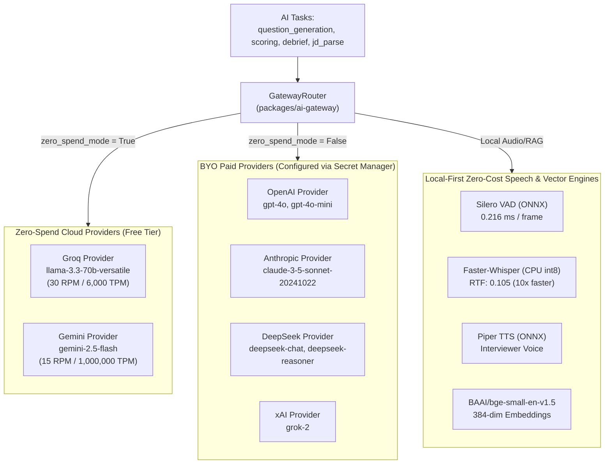

# PRAXIS InterviewOS — AI/ML Architecture & Model Governance Specification

**Document Version:** 1.0.0  
**Scope:** AI Gateway Single Boundary, Local Speech & Embedding Pipeline, Model Fallbacks, Budget Guards, Output Safety, and Model Governance.

---

## 1. Single Gateway Boundary Standard

PRAXIS strictly prohibits importing third-party LLM provider SDKs (`openai`, `anthropic`, `google-genai`, `groq`, etc.) anywhere outside the dedicated AI Gateway package:
- **Allowed Import Location:** `packages/ai-gateway/praxis_ai_gateway/providers/*.py`
- **Enforcement:** Enforced in CI via `scripts/check_gateway_boundary.py` and `backend/tests/test_architecture_boundaries.py`.
- **Interface Contract:** Core API routers, background workers, and realtime session managers interact with AI models exclusively via:
  ```python
  from praxis_ai_gateway.router import GatewayRouter, RoutingContext
  from praxis_ai_gateway.base import LLMMessage
  
  result = await router.route(
      task="question_generation",
      context=RoutingContext(user_id=uid, session_id=sid, zero_spend_mode=True),
      method_name="generate",
      messages=[...],
  )
  ```

---

## 2. Supported Provider & Capability Ecosystem



---

## 3. Resilience, Budgets & Circuit Breakers

### 3.1 Three-State Circuit Breaker (`CircuitBreaker`)
Every provider adapter is wrapped with a circuit breaker (`praxis_ai_gateway/resilience.py`):
- **Failure Threshold:** 3 consecutive failures (HTTP 5xx, timeout, or network drop).
- **Cooldown Interval:** 60 seconds in `OPEN` state. Requests immediately bypass tripped providers without incurring network timeouts.
- **Half-Open Probe:** After 60 seconds, allows a single probe call. Success resets state to `CLOSED`; failure resets cooldown.

### 3.2 Bounded Backoff Retry
- Retry on transient network errors or rate limits (HTTP 429) up to 2 attempts with exponential backoff:
  $$t_{\text{backoff}} = \min(t_{\text{max}}, t_{\text{base}} \times 2^{\text{attempt}}) \pm \text{jitter}$$
- Respects upstream `Retry-After` HTTP headers.

### 3.3 Strict Hierarchical Budget Guards (`BudgetGuard`)
Budgets are tracked in Redis and PostgreSQL (`packages/ai-gateway/praxis_ai_gateway/budget.py`):
1. **Per-Session Budget:** Max \$0.50 USD per interview session.
2. **Per-User Daily Budget:** Max \$2.00 USD per candidate per 24 hours.
3. **Global System Daily Budget:** Hard ceiling configured via `FREE_TIER_BUDGET_DAILY_USD`.
4. **Behavior on Budget Exceeded:** Raises typed `BudgetExceededError`. Never silently substitutes fake scores; notifies client via `AI_BUDGET_EXCEEDED`.

---

## 4. Local-First Speech & Embedding Pipeline

PRAXIS provides complete operational independence from cloud audio APIs:

1. **Silero Voice Activity Detection (VAD):**
   - Runs locally via `onnxruntime` on 512-sample (32ms) 16kHz PCM16 frames.
   - Verified benchmark latency: **0.216 ms per frame** (150x faster than real-time chunk duration).
   - Tolerates mid-sentence pauses up to 800ms before triggering turn completion (`tests/realtime/test_mid_sentence_pause.py`).
2. **Faster-Whisper Speech-to-Text (STT):**
   - Runs CTranslate2 quantized `int8` model (`tiny.en` / `small`) locally on CPU.
   - Measured benchmark: **0.743s transcription duration for 7.06s of audio (Realtime Factor: 0.105)**.
   - Delivers streaming partials (`transcript.partial`) and canonical segments (`transcript.final`).
3. **Piper Neural Text-to-Speech (TTS):**
   - Synthesizes interviewer voice locally using ONNX voice models (`en_US-lessac-medium`).
   - Returns 16kHz mono WAV audio chunks streamed to the client without external cloud egress.
4. **Dense BGE Embeddings:**
   - Model: `BAAI/bge-small-en-v1.5` (384 dimensions).
   - Generates normalized cosine embeddings locally in CPU memory.
   - Zero external API costs for resume indexing, job blueprint parsing, or vector similarity search.

---

## 5. Model Governance, Rubric Versioning & Provenance

Every AI evaluation generated across PRAXIS is strictly traceable and immutable:
- **Stored Provenance Fields:**
  - `provider`: Name of executing provider (`openai`, `anthropic`, `gemini`, `groq`).
  - `model`: Exact model identifier (`llama-3.3-70b-versatile`, `gpt-4o-mini`).
  - `prompt_version`: SHA-256 hash or semver of prompt template.
  - `rubric_version`: Version identifier of the scoring rubric (`v1.2`).
  - `tokens_input` / `tokens_output`: Token counts for financial and capacity tracking.
  - `latency_ms`: Exact roundtrip network + inference duration.
  - `validation_passed`: Boolean flag confirming Pydantic schema validation.
- **Rubric Stability:** Changes to scoring rubrics require updating `rubric_version` and running the behavioral and technical calibration suites (`backend/tests/evaluation/test_behavioral_calibration.py`, `realtime-agent/tests/evaluation/test_scoring_calibration.py`).
