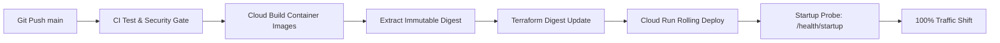

# PRAXIS Backend Operations & Maintenance Runbook

## 1. Health Probe Semantics & Container Lifecycle

All three backend compute units expose health endpoints configured for Cloud Run startup and liveness probes:

### 1.1 Core API Probes
| Endpoint | Type | Behavior | Target Response |
|---|---|---|---|
| `/health/live` | Liveness | Returns 200 immediately if Uvicorn event loop is responsive. | `{"status": "ok"}` |
| `/health/ready` | Readiness | Pings database (`SELECT 1`) and Redis (`PING`). Returns 503 if either dependency fails. | `{"status": "ready"}` (200) / 503 |
| `/health/startup` | Startup | Verifies that all 31 migrations in `supabase/migrations/` exist in `schema_migrations`. | `{"status": "ready", "migrations_current": true}` (200) / 503 |

### 1.2 Realtime Agent Probes
- `/health/live`: Returns 200 if WebSocket listener is initialized.
- `/health/ready`: Validates Redis session cache connectivity.

### 1.3 Worker Health Server
- ARQ worker starts an embedded `aiohttp` HTTP server on `$PORT` (default `8080`) answering `/health/live` and `/health/ready`.
- If worker event loop halts or encounters unhandled exit, the health server terminates, causing Cloud Run to replace the container.

---

## 2. Deployment & Rollback Lifecycle



### Rollback Procedure:
If a newly deployed Cloud Run revision triggers errors:
```bash
# 1. List recent revisions
gcloud run revisions list --service praxis-api --region asia-south1 --limit 5

# 2. Immediately route 100% of traffic back to the previous stable revision
gcloud run services update-traffic praxis-api \
  --to-revisions PREVIOUS_REVISION_NAME=100 \
  --region asia-south1
```

---

## 3. Secret Rotation Procedures

### 3.1 Supabase Access Token JWKS Rotation
- Supabase automatically rotates public signing keys.
- PRAXIS automatically refreshes the JWKS key set upon encountering an unknown `kid` in an incoming JWT header.
- No application downtime or restart is required during standard asymmetric key rotations.

### 3.2 Fernet Storage Encryption Key Rotation
When rotating `FERNET_KEY`:
1. Add `FERNET_KEY_OLD` containing the previous key to Secret Manager.
2. Update `FERNET_KEY` with the newly generated key.
3. Deploy revision; the decryption service attempts `FERNET_KEY` first and falls back to `FERNET_KEY_OLD` before re-encrypting with the new primary key.

---

## 4. Worker Queue Backlog & Dead-Letter Handling

### 4.1 Monitoring Queue Depth
Query pending ARQ jobs via Redis CLI:
```bash
redis-cli -u "$REDIS_URL" ZCARD "arq:queue"
```

### 4.2 Inspecting Failed Jobs
Jobs that exceed maximum retry attempts (`WORKER_MAX_TRIES = 3`) are logged and persisted in PostgreSQL:
```sql
SELECT id, job_name, error_type, error_message, attempts, failed_at
FROM failed_worker_jobs
ORDER BY failed_at DESC
LIMIT 20;
```

---

## 5. Critical Production Alerts

| Alert Name | Metric Condition | Severity | On-Call Response |
|---|---|:---:|---|
| `APIHighErrorRate` | 5xx HTTP responses > 1% over 5m | P1 | Inspect Cloud Logging `severity>=ERROR`; verify DB pool status. |
| `DBConnectionSaturation` | Active DB connections > 85% of limit | P1 | Check for connection leaks or Cloud Run over-scaling. |
| `WorkerQueueBacklog` | `arq:queue` count > 500 for 10m | P2 | Scale worker container instances. |
| `RealtimeDropRate` | Abrupt WebSocket disconnects > 5% | P1 | Check network ingress / Memorystore Redis connectivity. |
