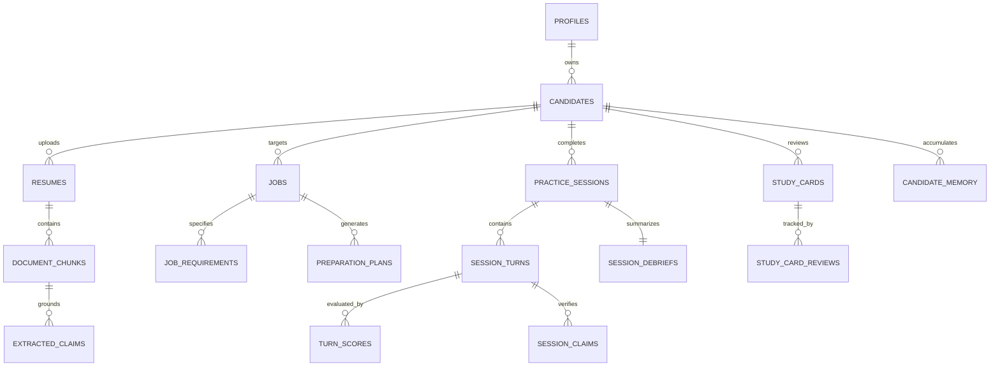

# PRAXIS InterviewOS — Database Architecture & Row-Level Security (RLS) Specification

**Document Version:** 1.0.0  
**Database Engine:** PostgreSQL 17+ / PostgreSQL 18.0 Native  
**Total Public Tables:** 71  
**Tables with RLS Enabled & Forced:** 70 (All business and application tables; `schema_migrations` tracking table excluded)  
**Migrations:** 31 Sequential SQL Migrations (`supabase/migrations/*.sql`)

---

## 1. Canonical Relational Data Model

PRAXIS models the complete candidate preparation and interview lifecycle across 25 primary domains:



---

## 2. Table Catalog, Constraints & Row Security Matrix

| Table Name | Primary Key | Foreign Key References | Owner Scope | Constraints & Indexes | RLS Policy | Retention & Cascading |
|---|---|---|---|---|---|---|
| `profiles` | `id` (UUID) | References `auth.users(id)` | User | Unique `id` | `auth.uid() = id` | Cascade on user delete |
| `candidates` | `id` (UUID) | `profile_id -> profiles.id` | Profile | B-tree index on `profile_id` | `auth.uid() = profile_id` | Cascade on profile delete |
| `candidate_skills` | `id` (UUID) | `candidate_id -> candidates.id` | Candidate | Unique `(candidate_id, name)` | Linked via candidate | Cascade on candidate delete |
| `candidate_experiences`| `id` (UUID) | `candidate_id -> candidates.id` | Candidate | B-tree on `candidate_id` | Linked via candidate | Cascade on candidate delete |
| `candidate_projects` | `id` (UUID) | `candidate_id -> candidates.id` | Candidate | B-tree on `candidate_id` | Linked via candidate | Cascade on candidate delete |
| `resumes` | `id` (UUID) | `candidate_id -> candidates.id` | Candidate | Unique primary resume flag | Linked via candidate | Cascade on candidate delete |
| `document_chunks` | `id` (UUID) | `document_id -> documents.id` | Document | HNSW Cosine vector index (384-dim) | Linked via document | Cascade on document delete |
| `jobs` | `id` (UUID) | `candidate_id -> candidates.id` | Candidate | Status check constraint | Linked via candidate | Cascade on candidate delete |
| `job_blueprints` | `id` (UUID) | `job_id -> jobs.id` | Job | Unique `job_id` | Linked via job | Cascade on job delete |
| `job_requirements` | `id` (UUID) | `job_id -> jobs.id` | Job | HNSW Cosine vector index (384-dim) | Linked via job | Cascade on job delete |
| `applications` | `id` (UUID) | `candidate_id -> candidates.id` | Candidate | Stage check constraint | Linked via candidate | Cascade on candidate delete |
| `practice_sessions` | `id` (UUID) | `candidate_id -> candidates.id` | Candidate | Mode check constraint | Linked via candidate | Cascade on candidate delete |
| `session_events` | `id` (UUID) | `session_id -> practice_sessions.id`| Session | B-tree on `(session_id, seq)` | Linked via session | Cascade on session delete |
| `session_turns` | `id` (UUID) | `session_id -> practice_sessions.id`| Session | B-tree on `(session_id, turn_idx)`| Linked via session | Cascade on session delete |
| `turn_scores` | `id` (UUID) | `turn_id -> session_turns.id` | Turn | Scores constrained `0.0` to `1.0` | Linked via turn | Cascade on turn delete |
| `session_claims` | `id` (UUID) | `session_id -> practice_sessions.id`| Session | 5-tier classification enum | Linked via session | Cascade on session delete |
| `session_debriefs` | `id` (UUID) | `session_id -> practice_sessions.id`| Session | Unique `session_id` | Linked via session | Cascade on session delete |
| `study_cards` | `id` (UUID) | `candidate_id -> candidates.id` | Candidate | B-tree on `(candidate_id, due_date)`| Linked via candidate | Cascade on candidate delete |
| `study_card_reviews` | `id` (UUID) | `card_id -> study_cards.id` | Card | Quality constrained `0` to `5` | Linked via card | Cascade on card delete |
| `candidate_memory` | `id` (UUID) | `candidate_id -> candidates.id` | Candidate | Unique `candidate_id` | Linked via candidate | Cascade on candidate delete |
| `question_bank` | `id` (UUID) | Curated Canonical | System | Domain, difficulty check (1-5) | Authenticated read-only; admin write | Permanent system content |
| `coding_problems` | `id` (UUID) | Curated Canonical | System | Test cases JSON array | Authenticated read-only; admin write | Permanent system content |
| `coding_submissions` | `id` (UUID) | `session_id -> practice_sessions.id`| Session | Language enum, pass count int | Linked via session | Cascade on session delete |
| `system_design_states`| `id` (UUID) | `session_id -> practice_sessions.id`| Session | Phase constrained 1 to 24 | Linked via session | Cascade on session delete |
| `worker_idempotency` | `key` (TEXT) | — | Worker | Expiring TTL timestamp | System internal | 7-day rolling partition |
| `audit_logs` | `id` (UUID) | Optional `profile_id` | Audit | Append-only, zero updates | Admin read-only | 90-day retention partition |

---

## 3. Row-Level Security (RLS) Implementation Details

### 3.1 Global `FORCE ROW LEVEL SECURITY`
In standard PostgreSQL, table owners and superusers bypass RLS policies by default. PRAXIS executes migration `20261004000002_force_rls.sql` which enforces:

```sql
DO $$
DECLARE
    r RECORD;
BEGIN
    FOR r IN (
        SELECT tablename
        FROM pg_tables
        WHERE schemaname = 'public'
          AND tablename NOT IN ('schema_migrations')
    ) LOOP
        EXECUTE format('ALTER TABLE public.%I ENABLE ROW LEVEL SECURITY;', r.tablename);
        EXECUTE format('ALTER TABLE public.%I FORCE ROW LEVEL SECURITY;', r.tablename);
    END LOOP;
END $$;
```

This guarantees that application connections running as `praxis_app` or table owners **strictly obey row isolation policies** without exception.

### 3.2 Tenant Context Setting
For every incoming request, the backend creates an isolated database session and sets the transaction-local configuration:

```sql
SET LOCAL request.jwt.claim.sub = '00000000-0000-0000-0000-000000000000';
SET LOCAL request.jwt.claim.role = 'authenticated';
```

RLS policies query `auth.uid()` which resolves:
```sql
CREATE OR REPLACE FUNCTION auth.uid() RETURNS UUID AS $$
    SELECT NULLIF(current_setting('request.jwt.claim.sub', true), '')::UUID;
$$ LANGUAGE SQL STABLE;
```

---

## 4. Connection Pool Hardening & Leak Defense

1. **Transaction-Local Isolation:**
   - Context settings are set using `SET LOCAL`, which automatically purges on transaction `COMMIT` or `ROLLBACK`.
   - Verified by `backend/tests/integration/test_rls_pool_leak.py`: A connection returned to the pool cannot leak previous candidate claims to subsequent requests.
2. **Pool Sizing & Budget:**
   - Configured in `Settings`:
     - `DB_POOL_SIZE`: 20 connections per instance.
     - `DB_MAX_OVERFLOW`: 10 connections.
     - `DB_POOL_TIMEOUT_S`: 30.0 seconds.
     - `DB_POOL_RECYCLE_S`: 1800 seconds (30 minutes).
     - `DB_POOL_PRE_PING`: True (validates connection vitality before checkout).
     - `DB_STATEMENT_TIMEOUT_MS`: 5000 ms (aborts runaway analytical queries).
