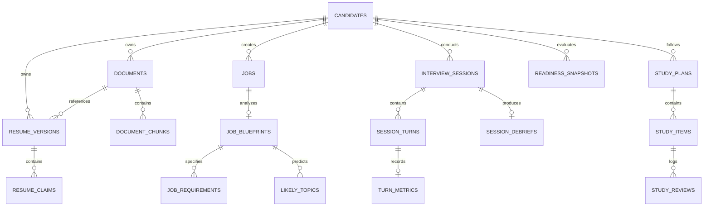

# PRAXIS Database Architecture

## 1. Overview & Technology Stack

The PRAXIS primary database is hosted on **Supabase PostgreSQL 17** with the `pgvector` extension enabled for semantic retrieval and vector similarity search.

- **Authoritative Migrations**: 31 sequential SQL migrations in `supabase/migrations/*.sql`.
- **Runtime Application Role**: `praxis_app` (`NOBYPASSRLS`). The application connects with least-privilege permissions and cannot bypass tenant isolation policies.
- **Pooling Mode**: Transaction pooling via Supabase PgBouncer (prepared statement cache disabled in asyncpg).
- **Vector Embeddings**: 384-dimensional dense vectors (`vector(384)`) generated by `BAAI/bge-small-en-v1.5`.

---

## 2. Core Domain Data Model



### 2.1 Identity, Candidate & Governance Domain
- `candidates`: Core candidate tenant table. Primary key `id UUID`, foreign key to Supabase `auth.users(id)` via `user_id`. Stores full name, email, target role, years of experience, and onboarding state.
- `profiles`: User preferences, notification flags, theme preferences, and localized settings.
- `audit_logs`: Immutable security and administrative actions tracking actor ID, action type, target resource, timestamp, and IP address.
- `feature_flags`: Tenant-level and global operational toggles with rollout percentages and override rules.

### 2.2 Resume Intelligence Domain
- `documents`: Raw uploaded artifacts (PDF, DOCX) tracking storage bucket, object path, MIME type, SHA-256 checksum, file byte size, and asynchronous extraction status (`pending`, `processing`, `ready`, `failed`).
- `resume_versions`: Parsed and normalized candidate resumes associated with an uploaded document.
- `document_chunks`: Extracted text segments with token count, chunk index, vector embedding (`vector(384)`), and model metadata (`BAAI/bge-small-en-v1.5`).
- `resume_claims`: Atomic, extractable claims (metrics, technologies, achievements, certifications) with provenance references and user verification state (`verified_by_user: boolean`).
- `candidate_skills` & `candidate_experiences`: Structured entities extracted from verified resume versions.

### 2.3 Job Intelligence Domain
- `jobs`: Target job opportunities created by the candidate with company name, role title, seniority level, and raw job description text.
- `job_blueprints`: Synthesized JD analysis capturing seniority signal, role scope, and evaluation focus.
- `job_requirements`: Categorized requirements (must-have skills, preferred skills, architectural domain expectations) with weighted priorities.
- `likely_topics`: Predicted technical and behavioral evaluation topics linked to interview question generation.

### 2.4 Interview Session Domain
- `interview_sessions`: Practice sessions tracking candidate ID, optional target job ID, interview mode (`behavioral`, `coding`, `system_design`, `mock_mixed`), active status (`created`, `authenticated`, `active`, `paused`, `reconnecting`, `completed`, `failed`), started/ended timestamps, and overall rating.
- `session_turns`: Individual conversational exchanges tracking speaker (`interviewer`, `candidate`), sequence number, question text, response transcript, audio duration, and timing metrics.
- `turn_metrics`: Quantitative DSP and audio features per turn: Words Per Minute (WPM), filler word rate, pause duration, tone signals, and latency.
- `session_debriefs`: Comprehensive post-interview summary containing headline metrics, key strengths, targeted weaknesses, flagged ungrounded claims, and job coverage scores.

### 2.5 Personalized Learning & Readiness Domain
- `study_plans`: Generated curriculum tailored to a specific candidate and target job role.
- `study_items`: Spaced repetition flashcards and review tasks adhering to the SuperMemo-2 (SM-2) algorithm. Tracks interval, ease factor, repetitions, and next review date.
- `study_reviews`: Individual card review event history recording submitted response quality (0–5 rating) and resulting schedule adjustment.
- `readiness_snapshots`: Longitudinal readiness estimates tracking candidate score progression over time across behavioral, coding, and system design dimensions.

---

## 3. Indexing & Vector Search Strategy

### 3.1 Vector Similarity Search (HNSW)
Semantic chunk retrieval is powered by Hierarchical Navigable Small World (HNSW) indexing using cosine distance:
```sql
CREATE INDEX IF NOT EXISTS idx_document_chunks_embedding
ON document_chunks USING hnsw (embedding vector_cosine_ops)
WITH (m = 16, ef_construction = 64);
```
- Query-time search uses the `<=>` cosine distance operator:
  ```sql
  SELECT id, content, 1 - (embedding <=> :query_embedding) AS similarity
  FROM document_chunks
  WHERE document_id = :doc_id
  ORDER BY embedding <=> :query_embedding
  LIMIT :k;
  ```

### 3.2 Full-Text Search (tsvector + GIN)
Lexical search across resumes and job descriptions uses PostgreSQL GIN indexes on full-text vectors:
```sql
CREATE INDEX IF NOT EXISTS idx_documents_content_fts
ON document_chunks USING gin (to_tsvector('english', content));
```

### 3.3 Foreign Key & Composite Performance Indexes
- All foreign keys are indexed to guarantee performant joins and prevent table locks on cascading deletes.
- Multi-column index on `session_turns(session_id, sequence_number ASC)` guarantees sequential order of turn reconstruction.
- Composite index on `study_items(candidate_id, next_review_at ASC)` optimizes spaced repetition scheduling queries.

---

## 4. Row-Level Security (RLS) Policy Architecture

All tenant-scoped tables enforce strict PostgreSQL Row-Level Security:
1. `ALTER TABLE <table_name> ENABLE ROW LEVEL SECURITY;`
2. `ALTER TABLE <table_name> FORCE ROW LEVEL SECURITY;` (prevents policy bypass by table owners).
3. **Tenant Claim Evaluation**:
   ```sql
   CREATE POLICY tenant_isolation_policy ON candidates
   FOR ALL TO praxis_app
   USING (user_id = (current_setting('request.jwt.claims', true)::jsonb ->> 'sub')::uuid)
   WITH CHECK (user_id = (current_setting('request.jwt.claims', true)::jsonb ->> 'sub')::uuid);
   ```
4. **Child Table Cascading Security**:
   Child tables (`documents`, `jobs`, `interview_sessions`, `study_plans`) evaluate ownership by joining against the authenticated candidate:
   ```sql
   CREATE POLICY tenant_jobs_policy ON jobs
   FOR ALL TO praxis_app
   USING (
     candidate_id IN (
       SELECT id FROM candidates
       WHERE user_id = (current_setting('request.jwt.claims', true)::jsonb ->> 'sub')::uuid
     )
   );
   ```
5. **No Token = Zero Rows**: If `request.jwt.claims` is unset or invalid, `(request.jwt.claims::jsonb ->> 'sub')` evaluates to `NULL`, returning 0 rows for all operations.
