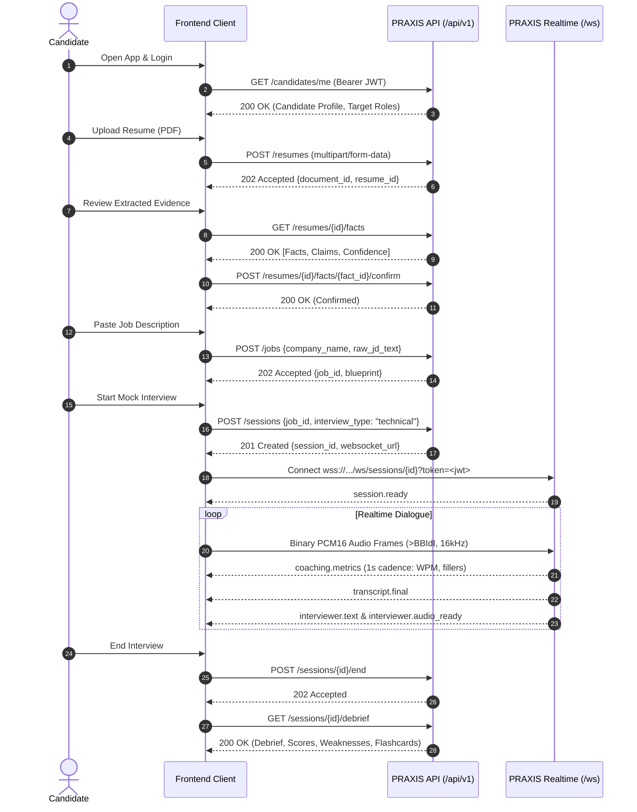

# PRAXIS InterviewOS — External Frontend Integration Guide

**Guide Version:** 1.0.0  
**Target Developers:** Web, iOS, Android, Desktop, and CLI engineers integrating with the PRAXIS Sovereign Backend.

---

## 1. Quickstart & Integration Overview

To build an independent client on top of PRAXIS InterviewOS, your frontend only needs two communication channels:
1. **REST API (`https://<api-host>/api/v1`):** Authentication, candidate profile, resume upload, job blueprints, and post-session analytics.
2. **WebSocket (`wss://<realtime-host>/ws/sessions/{session_id}`):** Realtime bidirectional audio streaming, live speech coaching, and interviewer audio playback.

No backend business logic, scoring formulas, or model SDKs need to be implemented on the client.

---

## 2. Step-by-Step Candidate Journey



---

## 3. Realtime Audio Client Implementation

### 3.1 Audio Capture Configuration
The client microphone must be configured to capture:
- **Sample Rate:** `16,000 Hz`
- **Channels:** `1` (Mono)
- **Sample Format:** `16-bit Signed Linear PCM` (Little-Endian)
- **Frame Duration:** `32 ms` (512 samples = 1024 bytes per frame)

### 3.2 Packing Binary Frame Header (TypeScript / Web Audio)
```typescript
/**
 * Packs 16kHz PCM16 audio chunk with the mandatory 18-byte PRAXIS binary header:
 * struct.pack(">BBIdI", proto_ver, frame_type, client_seq, capture_ts, payload_len)
 */
function packAudioFrame(pcm16Bytes: Uint8Array, clientSeq: number): ArrayBuffer {
  const HEADER_SIZE = 18;
  const payloadLen = pcm16Bytes.byteLength;
  const buffer = new ArrayBuffer(HEADER_SIZE + payloadLen);
  const view = new DataView(buffer);

  // Byte 0: Protocol Version (uint8) = 1
  view.setUint8(0, 1);
  // Byte 1: Frame Type (uint8) = 1 (Audio Chunk)
  view.setUint8(1, 1);
  // Bytes 2-5: Client Sequence Number (uint32, big-endian)
  view.setUint32(2, clientSeq, false);
  // Bytes 6-13: Capture Timestamp (float64, big-endian)
  view.setFloat64(6, Date.now() / 1000.0, false);
  // Bytes 14-17: Payload Length (uint32, big-endian)
  view.setUint32(14, payloadLen, false);

  // Copy raw PCM16 samples after 18-byte header
  new Uint8Array(buffer, HEADER_SIZE).set(pcm16Bytes);
  return buffer;
}
```

### 3.3 Handling Inbound Events (TypeScript)
```typescript
const ws = new WebSocket(`wss://api.praxis.internal/ws/sessions/${sessionId}?token=${jwtToken}`);
ws.binaryType = "arraybuffer";

ws.onmessage = (event) => {
  if (typeof event.data === "string") {
    const envelope = JSON.parse(event.data);
    switch (envelope.type) {
      case "coaching.metrics":
        // Update live HUD speaking rate
        updateHUD({
          wpm: envelope.payload.wpm,
          fillers: envelope.payload.filler_count,
          paceStatus: envelope.payload.pace_status
        });
        break;

      case "interviewer.text":
        displayInterviewerQuestion(envelope.payload.text);
        break;

      case "interviewer.audio_ready":
        // Play audio buffer (base64 WAV)
        playAudioFromBase64(envelope.payload.audio_base64);
        break;

      case "session.degraded":
        showBanner("Interviewer reasoning degraded. Speech coaching remains active.");
        break;
    }
  }
};
```

---

## 4. Transparent Reconnection & Recovery

If mobile WiFi drops or cellular towers hand over:
1. Listen for `ws.onclose` event.
2. If close code is normal drop (`1006` Abnormal Closure), immediately open a new WebSocket to the same URL within `30 seconds`.
3. Do **NOT** increment `sessionId`.
4. Keep sending subsequent audio frames with monotonically increasing `clientSeq`.
5. The PRAXIS Realtime agent recognizes the active session in Redis, binds the new connection socket, and resumes dialogue state without any loss of transcript history.
