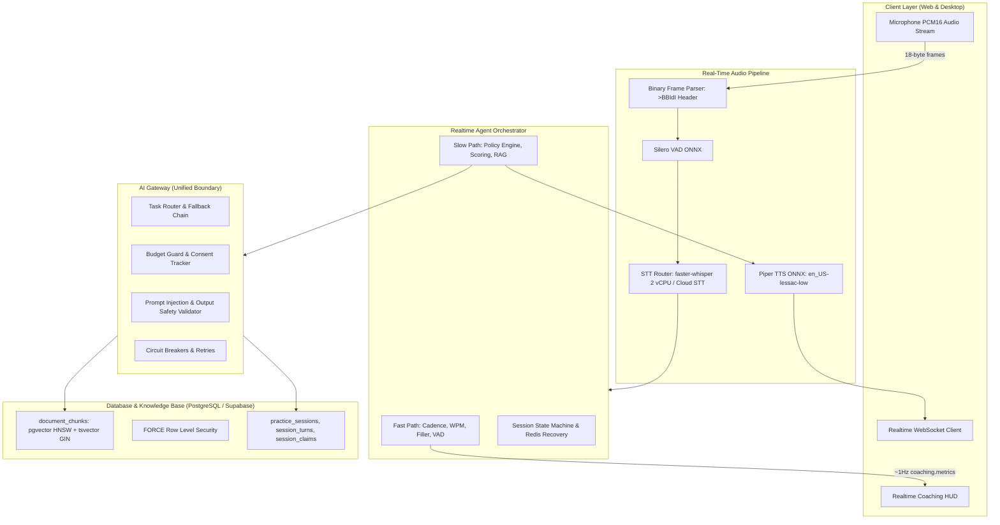

# PRAXIS InterviewOS — Phase 2 AI/ML Target Architecture

**Date**: 2026-11-01  
**Project**: PRAXIS InterviewOS (`AMIYA8597/praxis-interviewOS`)  
**Phase**: Phase 2 — AI/ML Intelligence  
**Classification**: COMPLETE SYSTEM ARCHITECTURE SPECIFICATION  

---

## 1. System Architecture Overview

PRAXIS InterviewOS combines realtime multimodal speech processing, candidate background retrieval, adaptive question generation, and evidence-grounded evaluation into a coordinated distributed platform:

---

## 2. Core Architectural Pillars

### 2.1 Audio Ingestion & Realtime Protocol
- Strict 18-byte big endian header (`>BBIdI`).
- Raw 16kHz mono 16-bit PCM streaming.
- Non-blocking fast path (< 10ms latency) for cadence and WPM delivery independent of slow-path LLM latency.

### 2.2 Candidate Context & Hybrid RAG
- Dual-channel retrieval combining `pgvector` HNSW cosine similarity (dense) and PostgreSQL `tsvector` BM25 (sparse lexical).
- Reciprocal Rank Fusion (RRF) with rank constant $k=60$.
- Strict cross-tenant isolation enforced by PostgreSQL RLS.

### 2.3 Evidence-Grounded Claim Verification
- 5-tier classification: `SUPPORTED`, `PARTIALLY_SUPPORTED`, `UNSUPPORTED`, `CONTRADICTED`, `UNCERTAIN`.
- No unverified claim silently becomes supported.
- Exact source chunk provenance and excerpt tracking.

### 2.4 Multimodal Rubric Scoring
- Normalized continuous scoring $[0.0, 1.0]$ across Correctness, Relevance, Structure, Specificity, Grounding, Conciseness.
- Missing measurements stored as `null` with `measurement_status="UNAVAILABLE"`, never fabricated zeros.
- Specialized rubrics for Coding (sandbox execution), System Design (24-step flow), and Behavioral (STAR methodology).

### 2.5 Gateway Boundary Integrity
- Zero direct provider SDK imports outside `packages/ai-gateway`.
- Automatic fallback chain across local and cloud providers.
- Hard zero-spend blocking and user consent validation.
