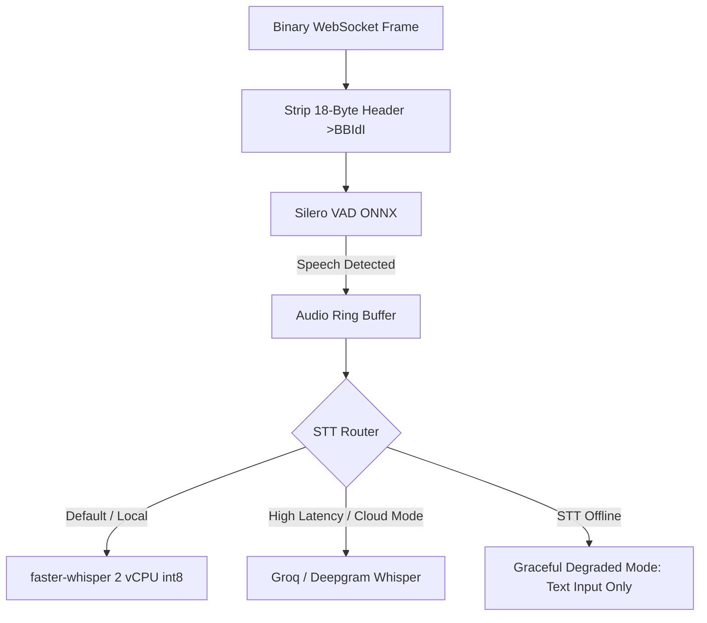

# PRAXIS InterviewOS — Phase 2 Audio Intelligence Architecture

**Date**: 2026-11-01  
**Project**: PRAXIS InterviewOS (`AMIYA8597/praxis-interviewOS`)  
**Workstream**: WORKSTREAM A — REAL-TIME AUDIO INTELLIGENCE  
**Classification**: PRODUCTION ARCHITECTURE SPECIFICATION  

---

## 1. Overview & Audio Transport Contract

PRAXIS receives streaming candidate microphone audio over a full-duplex binary WebSocket connection directly into `realtime-agent/app/main.py`.

### 1.1 Binary Frame Protocol (18-byte Header)
Audio data arrives as binary WebSocket frames prefixed with a strict 18-byte big-endian header (`>BBIdI`):

```
+---------------+---------------+--------------------+--------------------+--------------------+-------------------------------+
| proto_ver (1) | frame_type(1) | client_seq (4 B)   | capture_ts (8 B)   | payload_len (4 B)  | pcm16 payload (payload_len B) |
| uint8 = 1     | uint8 = 1     | uint32 big-endian  | float64 big-endian | uint32 big-endian  | 16kHz mono 16-bit PCM samples |
+---------------+---------------+--------------------+--------------------+--------------------+-------------------------------+
```

- **Validation Rules**:
  - `proto_ver == 1`: Unsupported protocol versions are rejected with frame error.
  - `frame_type == 1`: Identifies candidate audio PCM data.
  - `payload_len`: Must equal `len(data) - 18` exactly.
  - Byte Order: PCM samples are little-endian 16-bit signed integers (`int16`).
- **Frame Acknowledgment**:
  - The server regularly transmits `audio.frame_ack` envelopes back to the client (`{"seq": client_seq, "received_ts": ...}`) to maintain end-to-end flow control and network RTT estimation without starving the audio pipe.

---

## 2. Voice Activity Detection (Silero VAD)

Voice activity detection is executed using Silero VAD in ONNX format via `onnxruntime` (`CPUExecutionProvider`):
- **Chunk Size**: 512 samples at 16kHz = 32ms frame duration.
- **Onset Threshold**: `threshold = 0.5` across 3 consecutive frames (96ms sustained speech) to prevent transient mic clicks from triggering speech start.
- **Silence Hangover & Mid-Sentence Pause**:
  - Minimum silence duration to detect turn end: 550ms - 1500ms configurable.
  - Mid-sentence pauses (1.0s to 1.8s) do not immediately end candidate turn if the utterance ends with mid-sentence syntactic indicators or unfinished clauses.
- **State Machine Integration**:
  - Transitions `AWAITING_ANSWER` -> `CANDIDATE_TURN` on confirmed speech onset.
  - Emits `candidate.speech_start` and triggers barge-in if the AI interviewer is actively speaking.

---

## 3. Speech-to-Text Architecture & Fallback Hierarchy



1. **Local Primary**: `faster-whisper` (`LOCAL_STT_MODEL=small.en` or `tiny.en`, `compute_type="int8"`, `cpu_threads=2`).
2. **Cloud Fallback**: Cloud STT provider engaged if local RTF degrades above 0.70 during high CPU loads.
3. **Degraded Mode**: If speech transcription becomes unavailable, the WebSocket agent issues a `session.degraded` warning and continues the session via client-side `candidate.text_answer` frames without terminating the interview.

---

## 4. Reconnect & Session Recovery

- **Connection Loss**: Network drops trigger `SessionState.RECONNECTING` in Redis with a 30-second grace window (`WS_RECONNECT_GRACE_S=30`).
- **Resumption**: Reconnecting WebSocket sends the auth token and resumes with sequence continuity:
  - Sequence counters (`seq["next"]`) are restored from Redis hash state.
  - Last unacknowledged interviewer question is repeated with `repeat: true`.
  - In-progress transcripts are preserved.
