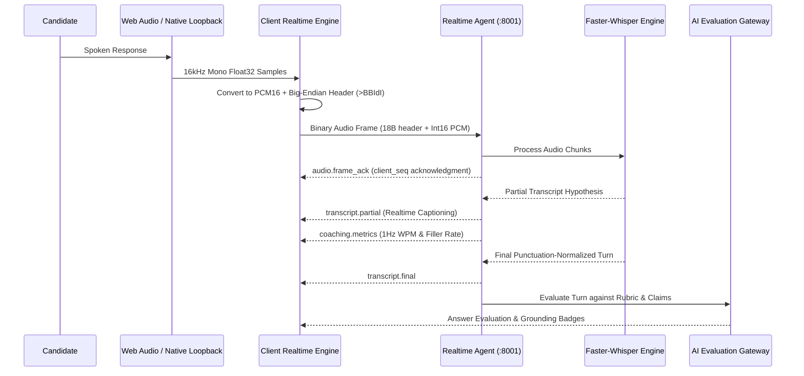

# PRAXIS InterviewOS — Phase 3 UI Architecture Specification

**Milestone**: Phase 3 — Web & Desktop Client Engineering  
**Branch**: `phase3-web-desktop`  
**Date**: 2026-11-01  
**Classification**: ARCHITECTURAL SPECIFICATION  

---

## 1. Architectural Philosophy & Principles

The PRAXIS client architecture is engineered as a zero-simulation, evidence-grounded presentation layer for the PRAXIS AI/ML intelligence engine.

### Core Architectural Invariants:
1. **No Client-Side Scoring or Business Logic**: All evaluation, speech-to-text, fact verification, and readiness estimation logic reside strictly on the backend and AI Gateway. Client applications present backend facts transparently.
2. **Measurement Status Transparency**: Unmeasured or degraded metrics are never synthesized or mocked. If an upstream signal is absent or incomplete, `measurement_status` reflects `ESTIMATED`, `DEGRADED`, or `UNAVAILABLE`.
3. **Strict Ethical Compliance (ADR-001)**: Absolute prohibition against proctor evasion, window cloaking, automated cheating overlays, or deceptive assistance.
4. **Resilient Realtime Transport**: Real-time speech streaming utilizes dual-path communication (binary PCM16 streaming over WebSockets + 1Hz fast-path coaching HUD).

---

## 2. Monorepo Topology & Boundaries

```
interviewOS/
├── apps/
│   ├── web/                     # Next.js 15 (App Router, React 19, Supabase SSR Auth)
│   │   ├── src/app/             # Route handlers & pages (sessions, debrief, readiness, study)
│   │   ├── src/lib/api/         # REST API clients matching backend contracts
│   │   └── src/lib/realtime/    # Resilient WebSocket client (backoff, heartbeat, sequence reconciliation)
│   └── desktop/                 # Electron 28+ (React 18, TypeScript, native audio)
│       ├── src/main/            # Electron main process (security sandbox, audio loopback)
│       ├── src/preload/         # Context-isolated secure IPC bridge
│       └── src/renderer/        # Practice Arena UI & low-latency Coaching HUD
├── packages/
│   ├── ui/                      # Shared design system conforming to WCAG 2.1 AA
│   └── types/                   # Authoritative TypeScript types matching PHASE2_HANDOFF_PHASE3.md
└── docs/                        # Specifications, benchmarks, and runbooks
```

---

## 3. Realtime Audio & WebSocket Data Flow



---

## 4. State Management Strategy

1. **Server State**: Managed via deterministic API fetch wrappers (`apiFetch`) with typed pagination, cursor tracking, and error translation (`ApiError`).
2. **Real-time Session State**: Event-driven finite state machine (`DISCONNECTED` → `CONNECTING` → `READY` → `CANDIDATE_TURN` → `ANALYZING_TURN` → `COMPLETED`).
3. **Local State**: Kept scoped inside view components using React hooks (`useState`, `useCallback`, `useRef`) to avoid unnecessary re-renders during high-frequency audio processing.
