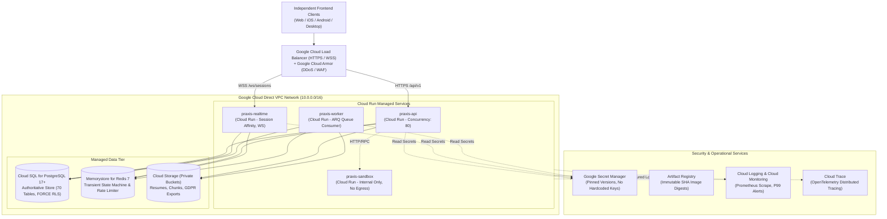

# PRAXIS InterviewOS — Google Cloud Production Architecture Specification

**Document Version:** 1.0.0  
**Target Platform:** Google Cloud Platform (GCP)  
**Primary Region:** `asia-south1` (Direct VPC Peering & High Availability)  
**Infrastructure as Code:** Terraform (`infra/gcp/main.tf`, `infra/terraform/`)  

---

## 1. Master System Topology

---

## 2. Microservice Container & Resource Matrix

| Service | Container Image Reference | CPU | Memory | Min / Max Instances | Ingress | Request Timeout | Health Probes |
|---|---|---|---|---|---|---|---|
| **`praxis-api`** | `${REGISTRY}/api:${SHORT_SHA}` | 2 vCPU | 2 GiB | 1 / 20 | All (via Cloud LB) | 60s | Startup: `/health/startup` Live: `/health/live` Ready: `/health/ready` |
| **`praxis-realtime`** | `${REGISTRY}/realtime:${SHORT_SHA}` | 2 vCPU | 4 GiB | 1 / 10 | All (Session Affinity) | 3600s (WS) | Startup: `/health/live` Live: `/health/live` Ready: `/health/ready` |
| **`praxis-worker`** | `${REGISTRY}/worker:${SHORT_SHA}` | 2 vCPU | 4 GiB | 1 / 5 | Internal Only | 900s | Internal health listener port 8000 |
| **`praxis-sandbox`** | `${REGISTRY}/sandbox:${SHORT_SHA}` | 1 vCPU | 512 MiB | 1 / 10 | Internal Only (No Egress) | 5s | Live: `/health/live` |

---

## 3. Secret Management & Workload Identity Federation

1. **Zero Committed Credentials:**
   - Production images contain zero `.env` files or API keys.
   - Pinned secrets are mounted into Cloud Run container environments directly from Google Secret Manager via IAM bindings:
     - `database-url` -> `DATABASE_URL`
     - `jwt-secret` -> `SUPABASE_JWT_SECRET`
     - `redis-url` -> `REDIS_URL`
     - `ai-provider-keys` -> `OPENAI_API_KEY`, `ANTHROPIC_API_KEY`, `GROQ_API_KEY`, `GEMINI_API_KEY`
2. **Workload Identity Federation for CI/CD:**
   - GitHub Actions connects to GCP without long-lived JSON service account keys.
   - Uses OIDC token exchange (`google-github-actions/auth`) granting ephemeral access to Cloud Build and Artifact Registry.

---

## 4. Immutable Release Policy: No `:latest` Tag

In strict accordance with Phase 14 engineering mandates:
- Every deployment artifact is pinned to its **immutable Git commit SHA (`${SHORT_SHA}`)** and cryptographic image digest (`sha256:...`).
- The `:latest` tag is prohibited in production deployments to guarantee that rollbacks point to identical container bits.
