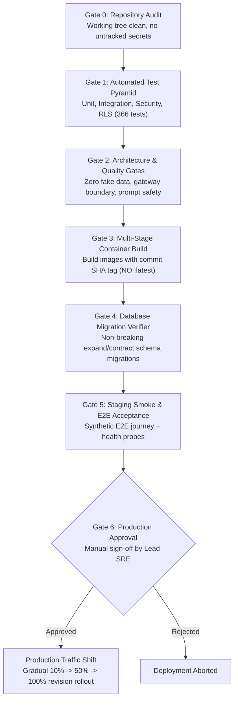

# PRAXIS InterviewOS — Release & Rollback Runbook

**Document Version:** 1.0.0  
**Scope:** Production deployments, immutable container promotion, zero-downtime release gates, and immediate rollback procedures.

---

## 1. Zero-Downtime Release Promotion Pipeline

PRAXIS enforces strict sequential release gates before any code reaches production:



---

## 2. Immutable Image Tagging Standard

Every container built by Google Cloud Build is tagged with:
- The short Git commit SHA: `${SHORT_SHA}` (e.g. `95f6b12`)
- The cryptographic SHA-256 image digest: `sha256:7b92...`

Deployments directly reference the immutable digest in Cloud Run:
```bash
gcloud run services update praxis-api \
  --image="asia-south1-docker.pkg.dev/<PROJECT_ID>/praxis/api@sha256:7b92f48..." \
  --region="asia-south1"
```
The `:latest` tag is strictly forbidden in production release commands.

---

## 3. Emergency Rollback Playbook

If a critical defect or regression is detected after production release:

### 3.1 Step 1: Immediate Cloud Run Traffic Rollback (< 2 Minutes)
Cloud Run maintains past revisions. Roll back 100% of incoming traffic to the previous known-good revision with zero rebuild time:

```bash
# List recent revisions
gcloud run revisions list --service=praxis-api --region=asia-south1 --limit=5

# Instantly divert 100% traffic back to previous stable revision
gcloud run services update-traffic praxis-api \
  --to-revisions=praxis-api-00042-xyz=100 \
  --region=asia-south1

gcloud run services update-traffic praxis-realtime \
  --to-revisions=praxis-realtime-00038-abc=100 \
  --region=asia-south1
```

### 3.2 Step 2: Database Expand/Contract Rollback Strategy
Database migrations in PRAXIS follow the **Expand/Contract pattern**:
- **Phase A (Expand):** New columns and tables are nullable or have defaults. Old application code continues functioning seamlessly.
- **Phase B (Contract):** Removal of deprecated columns occurs only in a subsequent release after all old revisions have terminated.

If a migration introduced an issue:
1. Do **NOT** manually edit applied migrations in `supabase/migrations/`.
2. Do **NOT** run destructive table drops on production tables containing candidate records.
3. Apply a forward-rolling corrective migration:
   ```bash
   python scripts/migrate.py
   ```

### 3.3 Step 3: Immediate WebSocket Session State Eviction
If a defect corrupted active Redis session states during the flawed release:
```bash
# Flush transient session keys without touching persistent database records
redis-cli -u $REDIS_URL --scan --pattern "session:state:*" | xargs redis-cli -u $REDIS_URL DEL
```
Clients will cleanly reconnect and re-initialize their session states.
