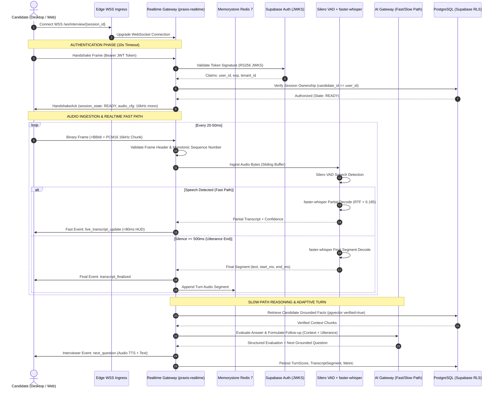
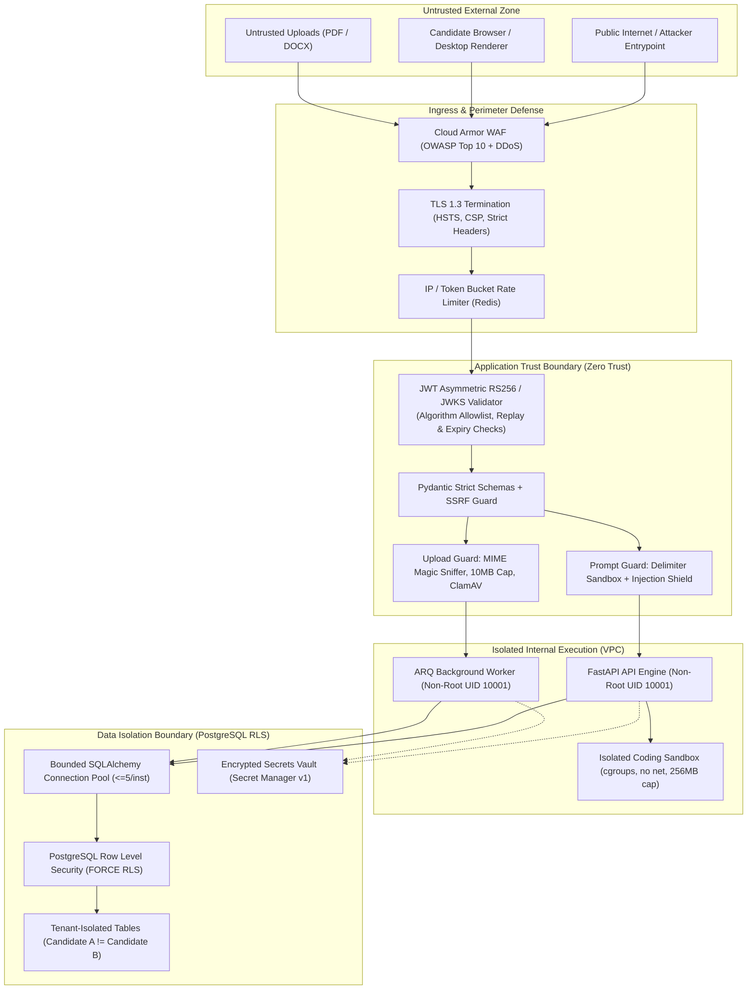
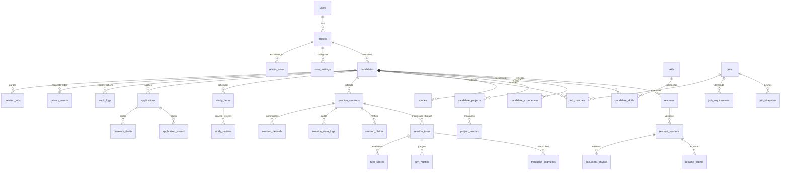
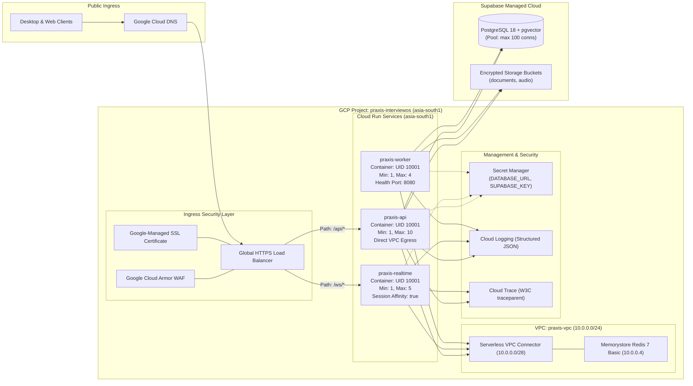
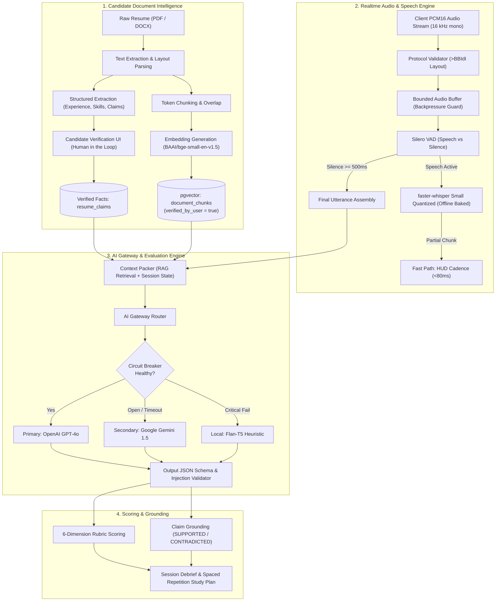

# PRAXIS InterviewOS — Master Architecture Diagrams

**Document ID**: ARCH-DIAGRAMS-MASTER  
**Milestone**: Four-Phase Engineering Rebuild  
**Standard**: Antigravity Pro 10/10 Engineering Standard  
**Format**: GitHub Flavored Markdown / Mermaid Diagrams  

---

## 5.1 Complete System Architecture

```mermaid
flowchart TD
    subgraph Clients["Client Layer"]
        Web["Web Client (Next.js 15 App Router)"]
        Desktop["Desktop Client (Electron + DPAPI Vault)"]
    end

    subgraph Edge["Edge & Ingress Security"]
        CDN["Cloud Armor & Cloud CDN"]
        WAF["WAF / Rate Limiter & SSL Termination"]
        EdgeLB["External HTTPS / WSS Load Balancer"]
        CDN --> EdgeLB
        WAF --> EdgeLB
    end

    Web -->|HTTPS / W3C Tracing| EdgeLB
    Desktop -->|WSS Binary Audio / REST| EdgeLB

    subgraph GCP["Google Cloud Platform (Region: asia-south1)"]
        subgraph CloudRun["Serverless Compute Cluster (Managed)"]
            APIGW["FastAPI Core Backend (praxis-api)\n2 vCPU, 2 GiB, Autoscale 1-10"]
            RTGW["Realtime Agent Gateway (praxis-realtime)\n4 vCPU, 4 GiB, Autoscale 1-5, Sticky WSS"]
            Worker["ARQ Background Workers (praxis-worker)\n2 vCPU, 2 GiB, Health Probe :8080"]
        end

        subgraph VPC["Private VPC Network (10.0.0.0/28)"]
            VPCConnector["Serverless VPC Access Connector"]
            RedisCluster[("Memorystore Redis 7\n10.0.0.4:6379\nQueue + RateLimit + State")]
        end

        subgraph Security["Cloud Security & Observability"]
            SecMgr["GCP Secret Manager (v1 Pinned)"]
            CloudTrace["Cloud Trace / OpenTelemetry Collector"]
            CloudLog["Cloud Logging (JSON + PII Redactor)"]
            Prometheus["Cloud Monitoring & Alerting"]
        end
    end

    EdgeLB -->|/api/*| APIGW
    EdgeLB -->|/ws/*| RTGW

    APIGW --> VPCConnector
    RTGW --> VPCConnector
    Worker --> VPCConnector
    VPCConnector --> RedisCluster

    APIGW -.-> SecMgr
    RTGW -.-> SecMgr
    Worker -.-> SecMgr

    APIGW --> CloudTrace
    RTGW --> CloudTrace
    Worker --> CloudTrace
    APIGW --> CloudLog
    RTGW --> CloudLog
    Worker --> CloudLog

    subgraph DataPlane["Durable Data & Identity Plane (Supabase)"]
        SupaAuth["Supabase Identity Provider\nRS256 / JWKS Cache + Auth"]
        SupaDB[("Supabase PostgreSQL 18\npgvector + Row Level Security (RLS)")]
        SupaStorage["Supabase Object Storage\nDocuments & Audio Vault"]
    end

    APIGW -->|JWT JWKS Verify| SupaAuth
    RTGW -->|Connection Auth| SupaAuth
    APIGW -->|AsyncPG Pool <= 5/inst| SupaDB
    Worker -->|AsyncPG Pool| SupaDB
    APIGW -->|Signed URL / Secure Upload| SupaStorage
    Worker -->|Document Extraction| SupaStorage

    subgraph AILayer["AI Gateway & Execution Boundaries"]
        AIGW["PRAXIS AI Gateway\nCircuit Breaker + Budget Guard"]
        WhisperVAD["Local In-Memory DSP Engine\nSilero VAD + faster-whisper (Offline)"]
        Sandbox["Coding Execution Sandbox\nIsolated Non-Root Worker (Docker)"]
    end

    RTGW --> WhisperVAD
    APIGW --> AIGW
    RTGW --> AIGW
    Worker --> AIGW
    APIGW --> Sandbox

    subgraph ExternalLLM["External LLM Providers"]
        OpenAI["Primary: OpenAI (GPT-4o)"]
        Gemini["Secondary: Google Gemini 1.5"]
        DeepSeek["Cost-Tier: DeepSeek-V3"]
        FlanT5["Offline Fallback: Local Flan-T5"]
    end

    AIGW -->|BYOK / Failover| OpenAI
    AIGW -.->|Fallback 1| Gemini
    AIGW -.->|Fallback 2| DeepSeek
    AIGW -.->|Local Degraded| FlanT5
```

---

## 5.2 Realtime Interview Sequence

---

## 5.3 Security Architecture & Trust Boundaries

---

## 5.4 Database Entity-Relationship Architecture

---

## 5.5 Deployment & Networking Architecture

---

## 5.6 AI/ML Architecture & Audio Intelligence

