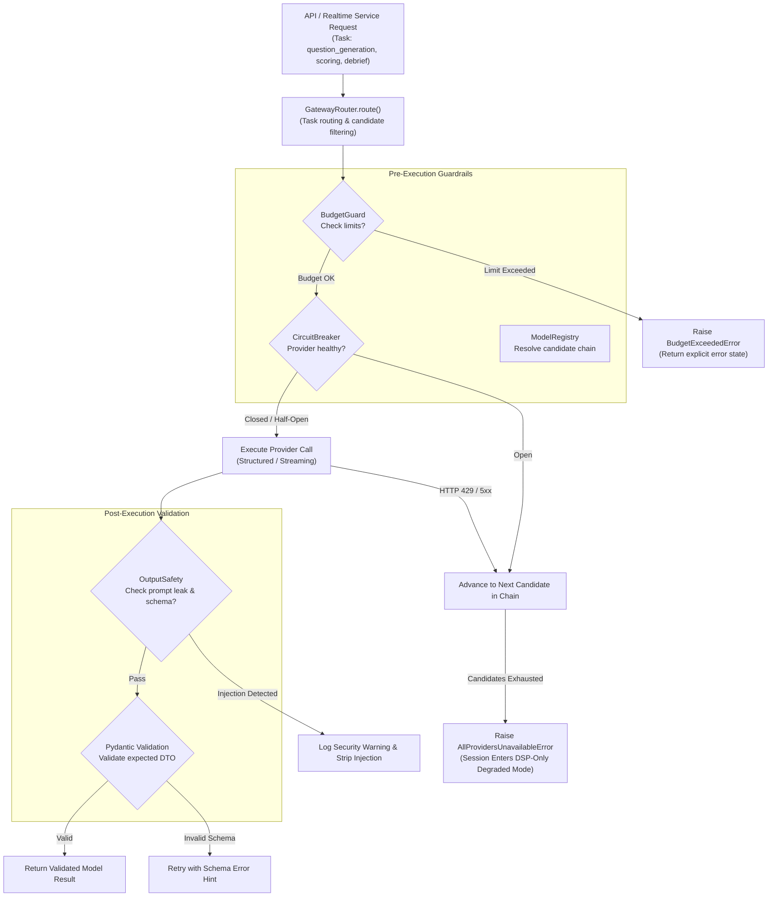

# PRAXIS InterviewOS — AI/ML Architecture & Model Catalog

**Audit Date:** 2026-11-04  
**Boundary Enforcement:** Strict single AI Gateway boundary (`packages/ai-gateway/praxis_ai_gateway`). Direct provider SDK imports are prohibited across `backend/app/` and `realtime-agent/`.  
**Execution Standard:** Local-first speech & embedding intelligence, resilient cloud LLM orchestration, structured Pydantic validation, explicit error degradation.

---

## 1. Provider & Model Registry

| Provider | Supported Engine / Model | Local / Cloud | Cost Tier | Capabilities | Runtime Status |
|---|---|---|---|---|---|
| **Google Gemini** | `gemini-2.5-flash`, `gemini-1.5-flash` | Cloud (Google Generative AI) | Free / Pay | Text, Stream, Structured, 1M Context | Implemented in `providers/gemini.py`; Local `.env` key revoked |
| **Groq** | `llama-3.3-70b-versatile` | Cloud (Groq LPUs) | Free / Pay | Fast Streaming, Structured (JSON mode) | Implemented in `providers/groq.py`; Empty key in local `.env` |
| **OpenAI** | `gpt-4o-mini`, `gpt-4o` | Cloud (OpenAI API) | Paid | Full multimodal, Structured Outputs | Implemented in `providers/openai.py`; Active valid key in `.env` |
| **Anthropic** | `claude-3-5-sonnet-20241022` | Cloud (Anthropic API) | Paid | Complex System Design & Coding Analysis | Implemented in `providers/anthropic.py`; Active valid key in `.env` |
| **DeepSeek** | `deepseek-chat`, `deepseek-reasoner` | Cloud (DeepSeek API) | Paid | Low-cost reasoning, mathematical proofs | Implemented in `providers/deepseek.py`; Active valid key in `.env` |
| **xAI** | `grok-2` | Cloud (xAI API) | Paid | General knowledge, adaptive drills | Implemented in `providers/xai.py`; Key not configured |
| **Ollama** | Local LLMs (`llama3`, `mistral`) | Local (HTTP API) | Zero Cost | Offline fallback, privacy-preserving | Implemented in `providers/ollama.py`; Optional local daemon |
| **Faster-Whisper**| `tiny.en`, `small` (CTranslate2 int8) | Local (CPU) | Zero Cost | Realtime STT, streaming partials | **VERIFIED** in `realtime-agent` (RTF 0.105) |
| **Silero VAD** | `silero_vad.onnx` (ONNX Runtime) | Local (CPU) | Zero Cost | Voice Activity Detection (32ms frames) | **VERIFIED** in `realtime-agent` (0.216 ms/frame) |
| **Piper TTS** | `en_US-lessac-medium.onnx` | Local (CPU) | Zero Cost | Low-latency interviewer voice synthesis | **VERIFIED** in `realtime-agent` |
| **BAAI BGE** | `BAAI/bge-small-en-v1.5` (384-dim) | Local (CPU) | Zero Cost | Dense vector embeddings for resumes & JDs | **VERIFIED** in `ai-gateway` |

---

## 2. Gateway Guardrails & Resilience Architecture



### Core Guardrail Specifications
1. **Zero-Spend Routing:** When `zero_spend_mode=True` or `FREE_TIER_MODE=true`, the router filters the provider registry strictly for free-tier candidates (`is_free_tier=True`), guaranteeing zero accidental cloud costs.
2. **Circuit Breaker:** Tracks consecutive failures per provider (threshold: 3 failures). Once tripped, provider transitions to `OPEN` state for a 60-second cooldown period, preventing request pileups and latency spikes.
3. **Structured Output Enforcement:** Models return structured JSON conforming to Pydantic models. Fenced markdown blocks (````json ... ````) are stripped defensively.
4. **Output Safety:** Verifies LLM responses against:
   - System prompt leakage phrases (`"You are an expert"`, `"system instructions"`).
   - Numerical score boundaries (scores constrained between 0.0 and 1.0 or 0 and 5).
   - Prompt injection reflection.
5. **No Fake Data Policy:** When all LLM providers fail, the gateway raises an explicit `AllProvidersUnavailableError`. The system degrades to audio DSP coaching and exposes `session.degraded` to the client. No fake scores or synthetic evaluations are ever fabricated.

---

## 3. Evaluation & Intelligence Pipelines

1. **5-Tier Claim Grounding:**
   - Evaluates candidate spoken claims against verified resume facts and project history.
   - Classifications: `SUPPORTED`, `PARTIALLY_SUPPORTED`, `UNSUPPORTED`, `CONTRADICTED`, `UNCERTAIN`.
   - Never promotes unverified or uncertain statements into ground truth.

2. **Behavioral STAR Scoring:**
   - Evaluates behavioral answers for Situation, Task, Action, and Result components.
   - Calibrated against 15 reference answers to ensure weak answers are not overcredited (`completeness < 0.50`) and strong answers receive full credit (`completeness > 0.90`).

3. **System Design 24-Phase Engine:**
   - Enforces a 24-phase progression: Requirements -> Capacity Estimation -> API Design -> Data Modeling -> High-Level Architecture -> Deep Dives -> Bottlenecks & Trade-offs.
   - Validates candidate architecture diagrams (nodes, edges, protocols) and detects single points of failure.

4. **SM-2 Spaced Repetition:**
   - Schedules flashcards for candidate interview weaknesses.
   - Computes repetition intervals using $EF' = EF + (0.1 - (5 - q) \times (0.08 + (5 - q) \times 0.02))$ where $EF \ge 1.30$.
