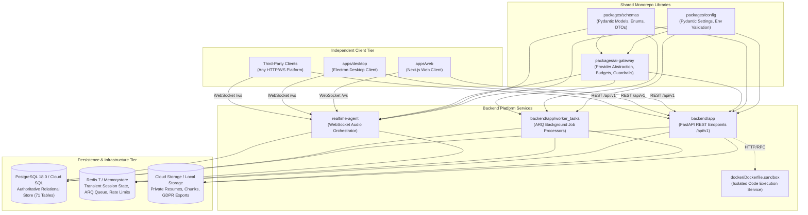

# PRAXIS InterviewOS — Dependency Graph & Boundary Architecture

**Audit Date:** 2026-11-04  
**Scope:** Internal monorepo package relationships, external runtime dependencies, boundary enforcement, and data flows.

---

## 1. Monorepo Package Relationship Graph

---

## 2. Strict Architectural Boundaries

1. **AI Gateway Single Boundary:**
   - Provider SDKs (`google-genai`, `groq`, `openai`, `anthropic`) are imported **exclusively** inside `packages/ai-gateway/praxis_ai_gateway/providers/`.
   - `backend/app/` and `realtime-agent/` interact with AI models solely through `GatewayRouter.route()`.
   - Verified by `scripts/check_gateway_boundary.py` (0 violations found).

2. **Database Boundary:**
   - All client queries must access database tables through the API service or Realtime agent.
   - External clients never receive direct database credentials.
   - All 71 PostgreSQL tables enforce `ROW LEVEL SECURITY` (`FORCE RLS` on candidate tables).

3. **Untrusted Code Sandbox Boundary:**
   - Candidate code execution is completely removed from the API and worker processes.
   - Execution runs in an isolated microservice container (`docker/Dockerfile.sandbox`) with:
     - No outbound network egress.
     - Strict execution timeouts (2 seconds wall-clock).
     - Memory limits (128 MB).
     - Fork bomb and process limits.
     - Non-root user execution (`nobody` / `appuser`).
     - Verified by `backend/tests/services/test_coding_sandbox.py` (7 tests passing).

4. **Transient vs. Authoritative State Separation:**
   - **PostgreSQL** is the sole authoritative store of business records (users, candidates, resumes, sessions, turns, scores, study cards, debriefs).
   - **Redis** is strictly transient (audio frame sequence numbers, websocket heartbeat timers, rate limiter token buckets, ARQ job queues). Redis loss does not destroy persistent candidate interview history.
