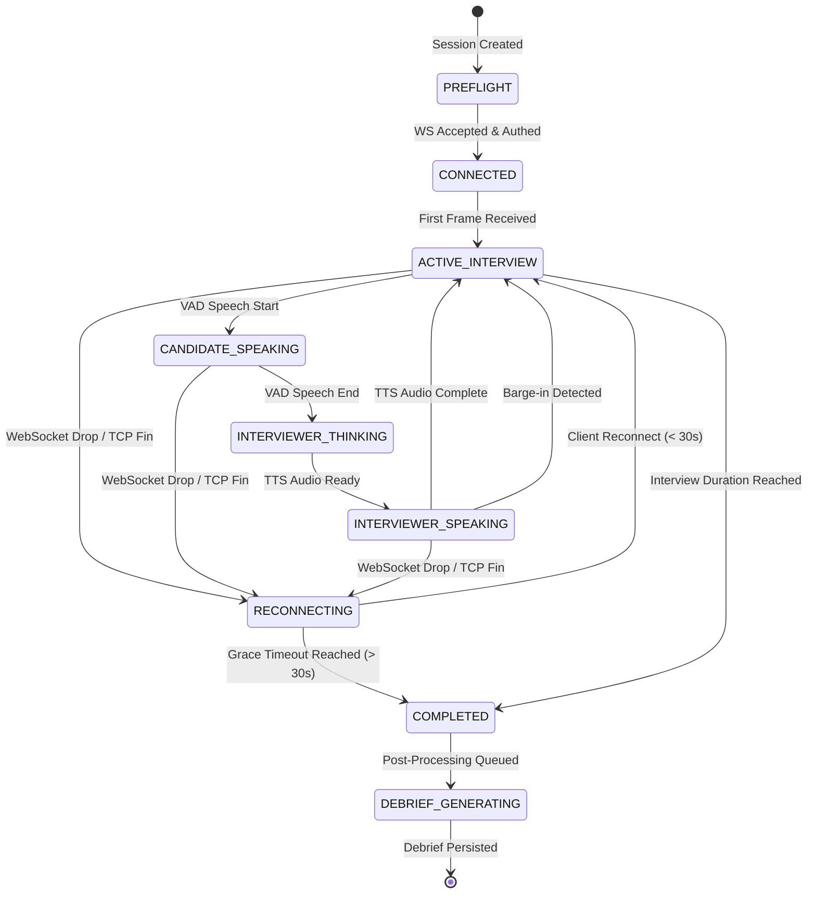

# PRAXIS InterviewOS — Realtime WebSocket Audio Protocol Inventory

**Audit Date:** 2026-11-04  
**Protocol Version:** v1 (`>BBIdI` binary frame header + JSON control envelopes)  
**Endpoint:** `wss://<host>/ws/sessions/{session_id}` (query parameter `?token=<jwt>` or initial auth JSON handshake)  
**Target Audio Format:** 16kHz, 1-channel (mono), 16-bit signed linear PCM (`audio/pcm;rate=16000;bits=16;channels=1`)  

---

## 1. Frame Architecture & Binary Specification

Audio frames transmitted from client (browser / desktop) to the Realtime Agent use a compact, 18-byte fixed binary header followed by raw PCM16 samples:

```
 0                   1                   2                   3
 0 1 2 3 4 5 6 7 8 9 0 1 2 3 4 5 6 7 8 9 0 1 2 3 4 5 6 7 8 9 0 1
+-+-+-+-+-+-+-+-+-+-+-+-+-+-+-+-+-+-+-+-+-+-+-+-+-+-+-+-+-+-+-+-+
| Protocol Ver  |  Frame Type   |         Client Sequence Number (4B)       |
+-+-+-+-+-+-+-+-+-+-+-+-+-+-+-+-+-+-+-+-+-+-+-+-+-+-+-+-+-+-+-+-+
|                                                               |
+                    Capture Timestamp (8B Float)               +
|                                                               |
+-+-+-+-+-+-+-+-+-+-+-+-+-+-+-+-+-+-+-+-+-+-+-+-+-+-+-+-+-+-+-+-+
|                      Payload Length (4B Uint)                 |
+-+-+-+-+-+-+-+-+-+-+-+-+-+-+-+-+-+-+-+-+-+-+-+-+-+-+-+-+-+-+-+-+
|                    Raw PCM16 Audio Samples ...                |
+-+-+-+-+-+-+-+-+-+-+-+-+-+-+-+-+-+-+-+-+-+-+-+-+-+-+-+-+-+-+-+-+
```

### Binary Header Field Definitions (`struct.unpack(">BBIdI")`)
1. **Protocol Version (`uint8`, 1 byte):** Must be `0x01`. Frames with other versions are immediately rejected.
2. **Frame Type (`uint8`, 1 byte):**
   - `0x01`: Audio Chunk (`PCM16` audio buffer).
   - `0x02`: Control / Heartbeat ping.
3. **Client Sequence Number (`uint32`, 4 bytes):** Monotonically increasing counter (0-indexed). Server detects and drops duplicates (`seq <= last_seq`) to eliminate network replay or out-of-order packet artifacts.
4. **Capture Timestamp (`float64`, 8 bytes):** Client-side wall-clock epoch time in seconds (`time.time()`). Used to compute exact transmission and processing latency.
5. **Payload Length (`uint32`, 4 bytes):** Byte length of the following PCM payload. Must match `len(raw_bytes) - 18` and must be an even integer (since PCM16 requires 2 bytes per sample).

---

## 2. Server Event Envelopes (`JSON`)

All messages sent from the Realtime Agent to the client use structured JSON envelopes:

```json
{
  "version": "1",
  "type": "event.type",
  "session_id": "uuid-v4",
  "sequence": 42,
  "timestamp": "2026-11-04T14:26:00.123456Z",
  "payload": {}
}
```

### Event Type Catalog
| Event Type | Direction | Payload Schema | Description |
|---|---|---|---|
| `session.ready` | Server -> Client | `{ "session_id": str, "mode": str }` | Emitted immediately after successful auth and session lookup. Client may begin streaming audio. |
| `state.transitioned` | Server -> Client | `{ "from_state": str, "to_state": str, "reason": str }` | Broadcasts lifecycle state changes (`PREFLIGHT` -> `ACTIVE` -> `PAUSED` -> `DEBRIEF`). |
| `audio.frame_ack` | Server -> Client | `{ "acked_seq": int, "server_ts": float }` | High-frequency sequence acknowledgement for client backpressure monitoring. |
| `speech_start` | Server -> Client | `{ "vad_prob": float, "timestamp": float }` | Silero VAD triggered voice activity detection. Client silences local TTS playback. |
| `speech_end` | Server -> Client | `{ "duration_ms": float, "samples": int }` | Silero VAD detected end of candidate utterance; triggers STT final transcription. |
| `transcript.partial` | Server -> Client | `{ "text": str, "stability": float }` | Streaming intermediate transcription from Faster-Whisper. |
| `transcript.final` | Server -> Client | `{ "text": str, "confidence": float, "duration_s": float }` | Canonical finalized candidate transcript segment. |
| `coaching.metrics` | Server -> Client | `{ "wpm": float, "filler_count": int, "pause_ms": float }` | Emitted on independent 1-second cadence from low-latency DSP metrics accumulator. |
| `interviewer.text` | Server -> Client | `{ "text": str, "turn_index": int }` | Next interviewer question, follow-up, or adaptive prompt from LLM policy. |
| `interviewer.audio_ready`| Server -> Client | `{ "audio_base64": str, "format": "wav" }` | Synthesized TTS speech audio for the interviewer prompt. |
| `turn.scoring_result` | Server -> Client | `{ "relevance": float, "correctness": float, "depth": float, "rationale": str }` | Multi-dimensional rubric score for the completed turn. |
| `session.degraded` | Server -> Client | `{ "provider": str, "reason": str, "mode": "DSP_ONLY" }` | Emitted if AI Gateway encounters provider failure; DSP metrics continue uninterrupted. |
| `debrief.ready` | Server -> Client | `{ "debrief_id": str, "headline": str }` | Emitted when final post-session evaluation has been persisted to the database. |

---

## 3. Distributed State Machine & Reconnection Semantics



### Reconnection Guarantees
- **State Storage in Redis:** Session state (`SessionState`), sequence number, turn index, and uncommitted audio buffers are stored in Redis under key `session:state:{session_id}` with a 300-second TTL.
- **Grace Period (`WS_RECONNECT_GRACE_S = 30.0`):** When TCP disconnects, the session enters `RECONNECTING` status. If the client reconnects within 30 seconds with valid credentials, the connection ID is rebound and streaming resumes with zero state loss.
- **Deduplication:** The server persists `last_client_seq`. Any retransmitted frame during reconnect is discarded if its sequence number is `<= last_client_seq`.

---

## 4. WebSocket Status & Close Codes

| Close Code | Constant | Meaning & Trigger |
|---|---|---|
| `4000` | `WS_BAD_REQUEST` | Malformed session ID or missing required connection parameters. |
| `4001` | `WS_AUTH_FAILED` | JWT missing, signature invalid, expired, or failed verification. |
| `4004` | `WS_NOT_FOUND` | Session does not exist or candidate profile does not own the session. |
| `4009` | `WS_CONFLICT` | Session has already completed or been aborted. |
| `4500` | `WS_INTERNAL` | Unhandled internal exception; session marked degraded. |
