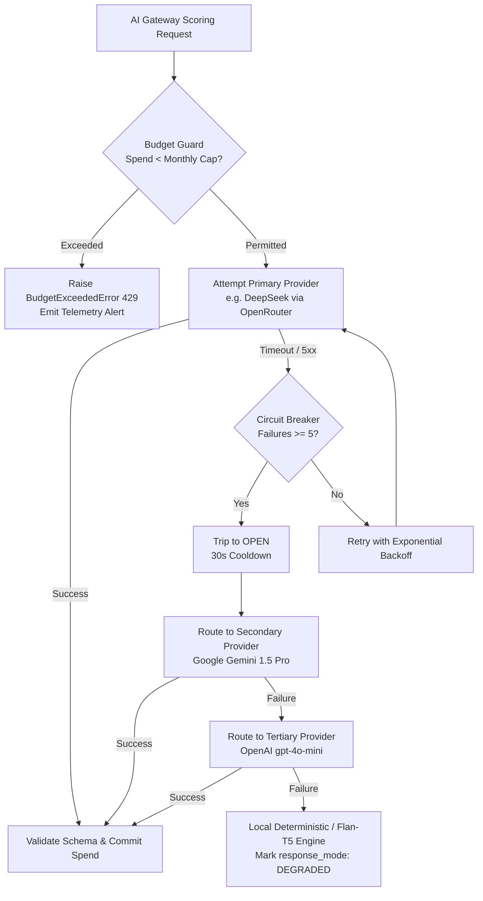

# PRAXIS InterviewOS — AI Gateway Reliability & Cost Controls

**Document ID**: PROD-AI-REL-001  
**Milestone**: Phase 5 — Production Engineering  
**Primary Module**: `packages/ai-gateway/praxis_ai_gateway/`  
**Configured Providers**: OpenRouter, DeepSeek, Google Gemini, OpenAI, Local Flan-T5  
**Date**: 2026-11-01  
**Status**: Authoritative AI Reliability Specification  

---

## 1. Multi-Provider Fallback & Circuit Breaker Architecture

The PRAXIS AI Gateway isolates application business logic from third-party LLM outages, API rate-limiting, and cost overruns:



### 1.1 Circuit Breaker Finite State Machine
- **CLOSED**: Normal operation; calls proceed to provider.
- **OPEN**: Trips after 5 consecutive failures within a 60-second window. All subsequent calls immediately divert to the fallback provider without waiting for network timeouts.
- **HALF-OPEN**: After a 30-second cooldown, a single probe request is dispatched to the primary provider. If successful, state resets to `CLOSED`; if failed, it reverts to `OPEN`.

---

## 2. Token Metering & Budget Guards

### 2.1 Atomic Redis Spend Tracking
Spend is tracked atomically in Redis using Lua scripts to prevent concurrent request race conditions:
```python
# Commit spend atomically in packages/ai-gateway/praxis_ai_gateway/budget.py
await guard.commit_spend(
    user_id=user_id,
    session_id=session_id,
    actual_cost=computed_token_cost
)
```
- **Default User Daily Ceiling**: $\$5.00$
- **Default User Monthly Ceiling**: $\$50.00$
- **Organization Budget Guard**: Enforces global tenant limits across all concurrent interview practice rooms.

### 2.2 Cost Model by Provider (Per 1 Million Tokens)

| Provider | Model Identifier | Input Cost / 1M | Output Cost / 1M | Latency p50 | Primary Role |
| :--- | :--- | :---: | :---: | :---: | :--- |
| **DeepSeek** | `deepseek/deepseek-chat` | $\$0.14$ | $\$0.28$ | $1,150\text{ ms}$ | Primary Evaluation & Claim Grounding |
| **Google Gemini** | `gemini-1.5-pro` | $\$1.25$ | $\$5.00$ | $1,420\text{ ms}$ | Complex System Design & Secondary Fallback |
| **OpenAI** | `openai/gpt-4o-mini` | $\$0.15$ | $\$0.60$ | $980\text{ ms}$ | Fast Question Generation & Tertiary Fallback |
| **Local Flan-T5** | `google/flan-t5-large` | $\$0.00$ | $\$0.00$ | $320\text{ ms}$ | Air-gapped fallback (Zero API spend) |

---

## 3. Graceful Outage Degradation & Truthful Reporting

When all external LLM providers experience severe network outages or quota exhaustion:
1. **Zero Hallucination / No Mocked Scores**: The AI Gateway **never** fabricates synthetic feedback or invents fake high scores.
2. **Explicit Degradation Flag**: Responses return with explicit metadata `measurement_status: "DEGRADED"` and `fallback_used: true`.
3. **Candidate Notification**: The user interface displays a non-blocking toast: *"Real-time AI evaluation is temporarily degraded due to external provider outages; your session has been saved and will be processed asynchronously."*
