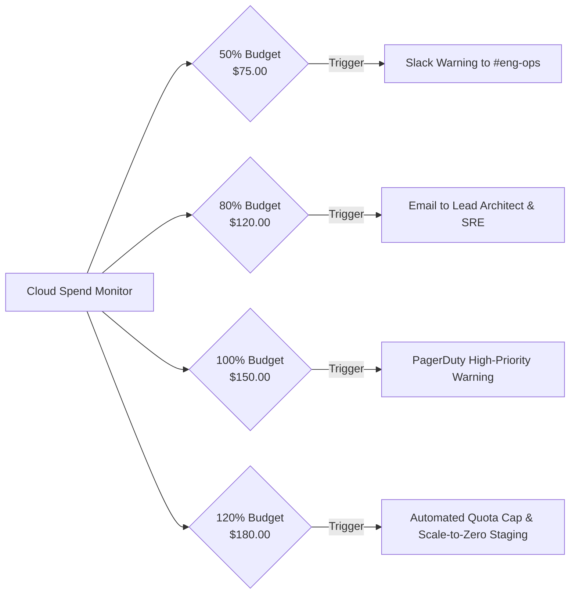

# PRAXIS InterviewOS — Budget Protection & Usage Controls

**Document ID**: PROD-BUDGET-001  
**Milestone**: Phase 5 — Production Engineering  
**Monthly Cloud Budget Target**: $\$150.00\text{ / month}$ (Staging + Production Baseline)  
**Date**: 2026-11-01  
**Status**: Authoritative Financial Guardrail Specification  

---

## 1. Cloud Infrastructure Budget Alerts

GCP Cloud Billing Budgets are configured with tiered notification thresholds to prevent cost overruns:



---

## 2. Programmatic AI Token Spending Ceilings

The AI Gateway enforces hard spending ceilings via Redis atomic counters:

| Quota Level | Spending Ceiling | Action Upon Breach | Recovery / Reset Cycle |
| :--- | :---: | :--- | :--- |
| **Session Quota** | $\$1.50$ | Session switches to local deterministic scoring | Ends at session completion |
| **User Daily Quota** | $\$5.00$ | Blocks subsequent LLM requests with HTTP 429 | Resets at 00:00:00 UTC |
| **Organization Monthly** | $\$50.00$ | Restricts new practice room creation | Resets on 1st of month |
| **Global Emergency Stop**| $\$150.00$ | Trips global circuit breaker to local Flan-T5 | Requires manual SRE override |

### Code Enforcement Invariant
```python
# packages/ai-gateway/praxis_ai_gateway/budget.py
if current_spend + estimated_cost > user_daily_limit:
    logger.warning("ai_budget_exceeded", extra={"user_id": user_id, "limit": user_daily_limit})
    raise BudgetExceededError("Daily AI practice quota reached. Resets at midnight UTC.")
```
