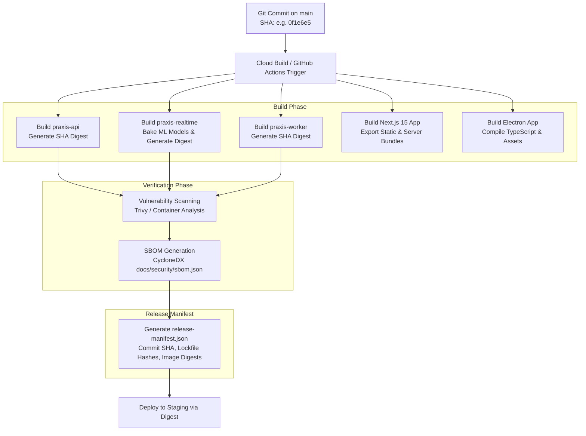

# PRAXIS InterviewOS — Build & Artifact Release Strategy

**Document ID**: PROD-ARTIFACT-001  
**Milestone**: Phase 5 — Production Engineering  
**Artifact Registry Location**: `asia-south1-docker.pkg.dev`  
**Tagging Policy**: Strict Immutable SHA (`${SHORT_SHA}`) — `:latest` Prohibited  
**Date**: 2026-11-01  
**Status**: Authoritative Artifact Management Policy  

---

## 1. Immutable Artifact Tagging Policy

To guarantee reproducibility, auditability, and deterministic rollbacks, PRAXIS enforces an **Immutable Release Tagging Policy**:

```
========================================================================================
  IMMUTABLE TAGGING INVARIANT
========================================================================================
  1. ALL container images are tagged strictly with the 7-character Git SHA (${SHORT_SHA}).
  2. The mutable tag ':latest' is NEVER pushed or deployed in staging or production.
  3. Deployments reference the exact image digest (sha256:...) generated during the build.
  4. Once an artifact digest is published to Artifact Registry, it CANNOT be overwritten.
========================================================================================
```

### Registry Paths by Service
- **Core REST API**:  
  `asia-south1-docker.pkg.dev/${REGISTRY_PROJECT}/praxis/praxis-api:${SHORT_SHA}`
- **Realtime WebSocket Service**:  
  `asia-south1-docker.pkg.dev/${REGISTRY_PROJECT}/praxis/praxis-realtime:${SHORT_SHA}`
- **Background Worker**:  
  `asia-south1-docker.pkg.dev/${REGISTRY_PROJECT}/praxis/praxis-worker:${SHORT_SHA}`

---

## 2. Multi-Stage Pipeline Artifact Flow



---

## 3. Web & Desktop Artifact Specifications

### 3.1 Next.js 15 Production Web Build (`apps/web`)
- **Compilation Command**: `pnpm --filter web run build` (`next build`)
- **Build Output**: `.next/standalone` folder containing the optimized production node server and static page chunks.
- **Route Optimization**: 15 pre-rendered static routes (`/`, `/admin`, `/analytics`, `/auth`, `/candidates`, `/onboarding`, `/platform/resume`, `/platform/tracker`, `/readiness`, `/sessions`, `/settings/providers`, `/study`).
- **Shared First-Load JS**: 102 kB shared across all pages, minimizing cold-start download times.
- **Security Headers**: Injected directly into Edge middleware (`apps/web/src/middleware.ts`) covering CSP, HSTS, and frame protections.

### 3.2 Electron Desktop Client Build (`apps/desktop`)
- **Compilation Command**: `pnpm --filter desktop run build` (`tsc`)
- **Packaging Pipeline**: Built using `electron-builder` producing platform-specific executables (Windows `.exe` installer / macOS `.dmg` / Linux `.AppImage`).
- **Code Signing**: Binaries are cryptographically signed using organization code-signing certificates before distribution.
- **Renderer Isolation**: Bundles only public client assets; zero server secrets or Node.js runtime bindings exposed to renderer.

---

## 4. Release Manifest Schema (`release-manifest.json`)

Every automated pipeline run produces an immutable release manifest recording the exact build provenance:
```json
{
  "release_id": "praxis-rel-20261101-0f1e6e5",
  "git_commit": "0f1e6e5d3584d80c143a560e5d63a7afee90b9da",
  "timestamp": "2026-11-01T18:05:00Z",
  "artifacts": {
    "api_image": "asia-south1-docker.pkg.dev/praxis-production/praxis/praxis-api:0f1e6e5",
    "api_digest": "sha256:7c8b21...9f",
    "realtime_image": "asia-south1-docker.pkg.dev/praxis-production/praxis/praxis-realtime:0f1e6e5",
    "realtime_digest": "sha256:3a1e45...b2",
    "worker_image": "asia-south1-docker.pkg.dev/praxis-production/praxis/praxis-worker:0f1e6e5",
    "worker_digest": "sha256:5e99c1...fa",
    "web_version": "1.0.0",
    "desktop_version": "0.1.0"
  },
  "sbom_hash": "e3b0c44298fc1c149afbf4c8996fb92427ae41e4649b934ca495991b7852b855",
  "approved_by": null,
  "staging_verified": true
}
```
