# PRAXIS InterviewOS — CI/CD Pipeline & Release Engineering

**Document ID**: PROD-CICD-001  
**Milestone**: Phase 5 — Continuous Integration & Continuous Deployment  
**Date**: 2026-11-01  
**Target Golden Branch**: `main`  
**Classification**: Continuous Delivery Architecture & Pipeline Specification  

---

## 1. Pipeline Overview

The PRAXIS InterviewOS CI/CD infrastructure is engineered for reproducible builds, zero-trust automated quality verification, and immutable artifact promotion across staging and production environments.

```mermaid
flowchart LR
    subgraph CI["1. Pull Request Gates (GitHub Actions)"]
        Lint["Lint & Format (ruff, eslint)"]
        Unit["Unit & Hardening Tests (pytest)"]
        Security["Security Baseline (63 tests + 0 secrets)"]
        BuildUI["UI & Desktop Suites (Jest 28/28 & 15/15)"]
        BuildWeb["Next.js 15 Build & tsc"]
    end

    subgraph Build["2. Artifact Generation (Cloud Build)"]
        DockerBuild["Multi-Stage Docker Build (Non-root UID 10001)"]
        ModelBake["faster-whisper Small Model Baking"]
        Scan["Container Vulnerability Scan (Trivy / Artifact)"]
        Push["Push to Artifact Registry (asia-south1)"]
    end

    subgraph Deploy["3. Continuous Delivery & Promotion"]
        StagingDeploy["Staging Deployment (Direct VPC Egress)"]
        SmokeE2E["Synthetic Candidate E2E Suite"]
        Approval{"Manual Release Approval"}
        ProdCanary["Production Canary Rollout (10% -> 100%)"]
    end

    Lint --> Unit --> Security --> BuildUI --> BuildWeb
    BuildWeb -->|Merge to main| DockerBuild
    DockerBuild --> ModelBake --> Scan --> Push
    Push --> StagingDeploy --> SmokeE2E --> Approval
    Approval -->|Approved| ProdCanary
```



---

## 2. Pull Request Gate Checklist

Every pull request targeted at `main` must pass all automated checks with zero skips, zero mocks, and zero suppressions:

1. **Static Analysis & Formatting**:
   - `uv run ruff check backend`
   - `uv run ruff check realtime-agent`
   - `pnpm --filter web lint`
2. **Backend Completeness Gate**:
   - `uv run python scripts/check_backend_completeness.py` (75/75 capabilities verified)
3. **Quality & Security Baseline**:
   - `uv run python scripts/final_quality_gate.py` (15/15 checks green)
   - `uv run python scripts/security/security_baseline.py` (0 hardcoded secrets, 63 security tests)
   - `uv run pytest backend/tests/hardening/` (55 tests)
   - `uv run pytest backend/tests/production/` (6 tests)
4. **AI Gateway & Data Integrity Boundaries**:
   - `uv run python scripts/check_gateway_boundary.py` (0 direct provider SDK imports)
   - `uv run python scripts/check_no_fake_data.py` (0 mock data in runtime paths)
   - `uv run python scripts/check_prompt_construction_boundary.py` (0 unsafe prompt concats)
5. **Client Applications & Builds**:
   - `pnpm --filter @praxis/ui test` (28/28 Jest tests passing)
   - `pnpm --filter desktop test` (15/15 Jest tests passing)
   - `pnpm build:desktop` (tsc clean)
   - `pnpm build:web` (Next.js 15 App Router production build)

---

## 3. Immutable Artifact Policy & SBOM

- **Image Tagging**:
  - Pull Request builds: `pr-${PR_NUMBER}-${SHORT_SHA}`
  - Staging builds: `staging-${SHORT_SHA}`
  - Production builds: Immutable digest `sha256:<64_hex_chars>`
- **Promotion Rule**: Images deployed to production are **never rebuilt from source code**. The exact container image digest validated in staging is promoted directly to production.
- **Software Bill of Materials (SBOM)**: Generated at `sbom.json` following CycloneDX/SPDX standards to guarantee full dependency provenance.

---

## 4. Rollback Strategy & MTTR

If anomalies or elevated error rates are detected post-deployment:
1. **Cloud Run Traffic Cutback**: Revert traffic to the previous known good revision via single command:
   ```bash
   gcloud run services update-traffic praxis-api --to-revisions=praxis-api-golden=100 --region=asia-south1
   ```
   **Mean Time to Recovery (MTTR)**: $< 45\text{ seconds}$.
2. **Database Backward Compatibility**: All database migrations follow the expand/contract design pattern. The previous application revision remains 100% compatible with the newly expanded schema.
