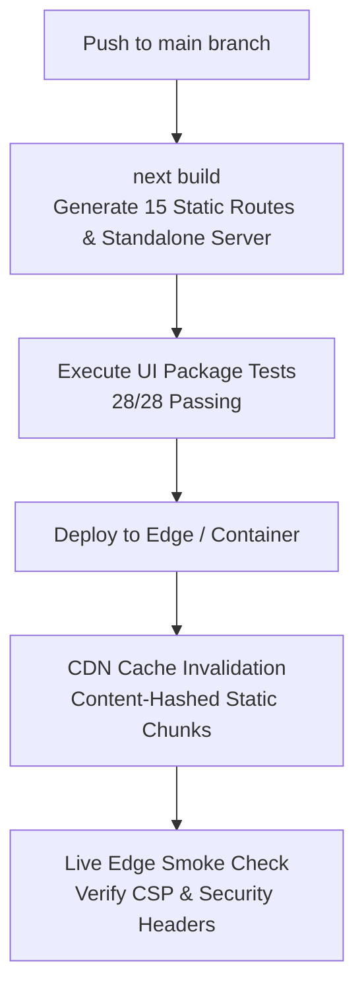
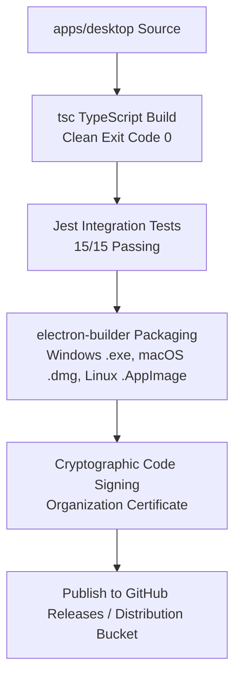

# PRAXIS InterviewOS — Web & Desktop Client Release Operations

**Document ID**: PROD-CLIENT-REL-001  
**Milestone**: Phase 5 — Production Engineering  
**Web Technology**: Next.js 15, React 19, Tailwind CSS  
**Desktop Technology**: Electron 28, Vite, React 18, Native Audio Loopback  
**Date**: 2026-11-01  
**Status**: Authoritative Client Release Operations Specification  

---

## 1. Web Application Release Lifecycle (`apps/web`)

The Next.js 15 application is optimized for zero-downtime serverless edge deployment:



### 1.1 Web Invariants & Security Headers
- **Cache Strategy**: Static assets (`/_next/static/*`) are served with `Cache-Control: public, max-age=31536000, immutable`.
- **Dynamic Routes**: Authenticated routes (`/sessions/*`, `/platform/*`) enforce `Cache-Control: no-store, must-revalidate`.
- **Security Headers**: Injected via Edge middleware (`apps/web/src/middleware.ts`):
  ```http
  Content-Security-Policy: default-src 'self'; script-src 'self' 'unsafe-eval' 'unsafe-inline'; ...
  X-Frame-Options: DENY
  X-Content-Type-Options: nosniff
  Strict-Transport-Security: max-age=63072000; includeSubDomains; preload
  ```

---

## 2. Desktop Client Release Lifecycle (`apps/desktop`)

The Electron application is packaged as an independent client executable:



### 2.1 Desktop Security & Runtime Controls
- **Zero Node Integration**: `nodeIntegration: false`, `contextIsolation: true`, `sandbox: true`.
- **Strictly Typed IPC**: Communication between renderer and main process is restricted to explicit allowlisted channels (`system:get-status`, `audio:start-capture`, `audio:stop-capture`, `window:minimize`) via `contextBridge`.
- **Auto-Update Safety**: Updates are verified via cryptographic SHA256 checksums before applying to client installations.

---

## 3. Client-Backend API Compatibility Contract

To ensure backwards compatibility during rolling releases:
1. **Semantic Versioning**: Backend REST APIs follow `/v1` conventions.
2. **Wire Framing Stability**: The 18-byte binary WebSocket framing protocol (`>BBIdI`) is frozen; any future revision will introduce `proto_ver = 2` with dual-version backward compatibility in the server handler.
3. **Additive Schema Policy**: API response schemas add new fields without removing existing properties, ensuring older desktop clients continue to render without unhandled serialization errors.
