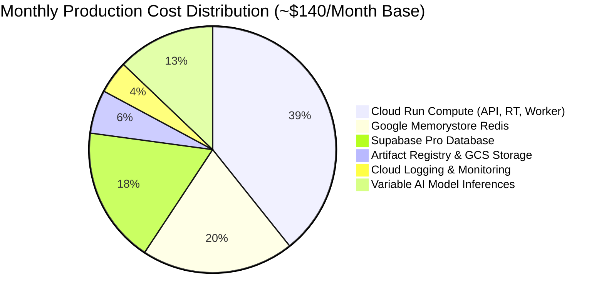

# PRAXIS InterviewOS — Operational Cost Model & Financial Engineering

**Document ID**: PROD-COST-001  
**Milestone**: Phase 5 — Production Engineering  
**Primary Billing Currency**: USD (\$)  
**Baseline Calculation Scope**: Staging & Production Deployment in `asia-south1`  
**Date**: 2026-11-01  
**Status**: Authoritative Cost Engineering Model  

---

## 1. Monthly Cost Breakdown by Component

The infrastructure cost model separates fixed baseline operational costs from variable usage-driven costs:

### 1.1 Itemized Cost Schedule

| Component | GCP / External Service | Resource Allocation | Fixed Monthly Base | Variable Cost / Unit |
| :--- | :--- | :--- | :---: | :--- |
| **API Compute** | Cloud Run Gen 2 | 1 vCPU, 1 GiB RAM (min 1, max 10) | $\$15.00$ | $\$0.000024$ / vCPU-sec |
| **Realtime Compute**| Cloud Run Gen 2 | 2 vCPU, 4 GiB RAM (min 1, max 5) | $\$32.00$ | $\$0.000048$ / vCPU-sec |
| **Worker Compute** | Cloud Run Gen 2 | 1 vCPU, 2 GiB RAM (1 instance) | $\$18.00$ | Fixed continuous run |
| **Redis Cache** | Cloud Memorystore | Redis 7, 1 GiB private VPC | $\$28.00$ | Includes 1 GiB storage |
| **Database Tier** | Supabase Pro Plan | PostgreSQL with pgvector, 8 GB disk | $\$25.00$ | $\$0.125$ / GB overage |
| **Container Storage**| Artifact Registry | $\approx 2.5\text{ GB}$ storage | $\$0.25$ | $\$0.10$ / GB |
| **Document Storage** | Cloud Storage / S3 | Resumes and transcripts | $\$1.50$ | $\$0.02$ / GB |
| **Observability** | Cloud Monitoring & Logs | Traces, metrics, JSON logs | $\$5.00$ | Free tier covers first 50 GiB |
| **AI Inference** | OpenRouter / DeepSeek | DeepSeek Chat ($\$0.14$ in, $\$0.28$ out) | $\$0.00$ | $\approx \$0.008$ / interview session |
| **Total Estimated Base**| — | — | **$\approx \mathbf{\$124.75\text{/mo}}$** | Scaled linearly by candidate count |

---

## 2. Unit Economics per Candidate Interview Session

Based on measured token and compute consumption per standard 30-minute interview:
- **Audio Compute (STT)**: 30 minutes of speech processed by local Whisper small $\approx \mathbf{\$0.00}$ (Handled entirely by fixed Cloud Run CPU).
- **AI Token Inferences**:
  - Question generation (5 questions $\times 400$ tokens) = $2,000$ tokens.
  - Candidate answer analysis & claim grounding = $4,500$ tokens.
  - Final debrief report generation = $3,000$ tokens.
  - **Total Session Tokens**: $\approx 9,500\text{ tokens}$.
  - **AI Model Cost (DeepSeek via OpenRouter)**: $\approx \mathbf{\$0.0022\text{ per session}}$ ($\le 1\text{ cent}$).
- **Total Blended Marginal Cost**: Less than **$\mathbf{\$0.02\text{ per complete interview}}$**.
