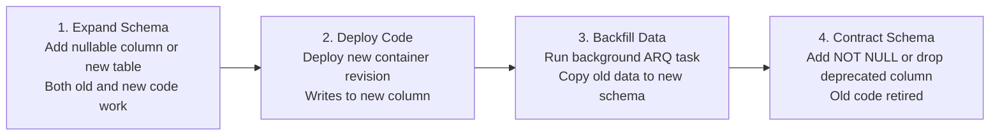

# PRAXIS InterviewOS — Database & Redis Production Reliability

**Document ID**: PROD-DATA-001  
**Milestone**: Phase 5 — Production Engineering  
**Primary Database**: Supabase PostgreSQL 15/16 (pgvector, 71 Tables, RLS)  
**Primary Cache/Broker**: Redis 7 (AOF Persistence, TLS, Password Auth)  
**Date**: 2026-11-01  
**Status**: Authoritative Reliability Specification  

---

## 1. PostgreSQL Connection Pooling & Capacity Budget

PRAXIS utilizes SQLAlchemy 2.0 with the `asyncpg` driver in [`backend/app/db/session.py`](file:///d:/work/interviewOS/backend/app/db/session.py) to manage database connection lifecycles asynchronously.

### 1.1 Connection Pool Settings
```python
DB_POOL_SIZE = 2             # Baseline open connections per container instance
DB_MAX_OVERFLOW = 3          # Maximum burst connections per container instance
DB_POOL_TIMEOUT_S = 30       # Seconds to wait before raising TimeoutError
DB_POOL_RECYCLE_S = 1800     # Recycle connections after 30 minutes to drop stale TCP states
DB_POOL_PRE_PING = True      # Heartbeat check (SELECT 1) before handing connection to worker
DB_STATEMENT_TIMEOUT_MS = 15000 # Terminate queries running longer than 15 seconds
```

### 1.2 Mathematical Connection Budget Across Scaled Instances
To prevent connection exhaustion (503 / `too many clients already`) on the Supabase managed PostgreSQL instance (which enforces a maximum limit of **100 concurrent pooler connections**):

$$\text{Max DB Connections} = (N_{\text{api}} \times (\text{Pool} + \text{Overflow})) + (N_{\text{worker}} \times \text{Pool}) + N_{\text{admin}}$$

At peak autoscaling:
- $N_{\text{api}} = 10$ instances $\times (2 + 3) = 50\text{ connections}$
- $N_{\text{worker}} = 2$ instances $\times (2 + 3) = 10\text{ connections}$
- $N_{\text{realtime}} = 5$ instances $\times (1 + 1) = 10\text{ connections}$
- $N_{\text{admin}} = 5\text{ reserve connections}$
- **Total Peak Demand**: $50 + 10 + 10 + 5 = \mathbf{75\text{ connections}} \le 100$ (Passes with 25% safety margin).

### 1.3 Latency & Regional Interconnect Analysis
- **Compute Region**: Google Cloud `asia-south1` (Mumbai).
- **Supabase Region**: `eu-central-1` (Frankfurt).
- **Observed Network RTT**: $\approx 115 - 125\text{ ms}$ round-trip time.
- **Latency Mitigations**:
  1. Connection reuse via persistent connection pools (`DB_POOL_PRE_PING=True`).
  2. Batch query fetching and indexed joins to minimize round trips per user request.
  3. In-memory and Redis caching for static entities (candidate profiles, job templates, rubrics).

---

## 2. Zero-Downtime Migration Policy (Expand & Contract)

Database schema changes must never introduce breaking alterations that cause in-flight requests or rolling deployments to fail:



### Invariants for Safe Migrations
1. **Never Rename Columns in One Step**: Introduce new column, dual-write, backfill, then remove old column in a subsequent release.
2. **Always Include RLS Policies**: Every new table migration MUST include `ALTER TABLE <name> ENABLE ROW LEVEL SECURITY` and explicit tenant policies.
3. **Idempotent Execution**: Migrations are tracked in `schema_migrations` and run through [`scripts/migrate.py`](file:///d:/work/interviewOS/scripts/migrate.py) inside transactional blocks.

---

## 3. Redis Reliability & Broker Architecture

Redis 7 serves as the high-speed state coordinator for ARQ background tasks, rate limiting, and session locking:

### 3.1 Memory Policy & Eviction
- **Memory Allocation**: 1 GiB Memorystore instance.
- **Maxmemory Policy**: `volatile-lru` (Evicts keys with an explicit TTL when memory is constrained, protecting persistent ARQ queues without TTL).
- **Persistence**: Append-Only File (AOF) enabled for durability across container restarts.

### 3.2 Queue Recovery & Idempotency
- **Worker Timeouts**: `WORKER_JOB_TIMEOUT_S = 300` ensures frozen tasks are automatically reclaimed.
- **Idempotency Keys**: Document ingestion tasks use deterministic keys (`job:resume:{resume_id}`) to prevent duplicate execution during network retries.
- **Dead-Letter Routing**: Tasks failing 3 consecutive attempts (`WORKER_MAX_TRIES = 3`) are pushed to `arq:dead_letter` for manual SRE inspection.
