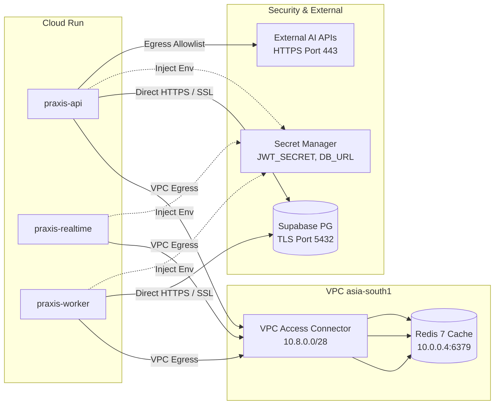

# PRAXIS InterviewOS — Deployment Architecture Specification

**Document ID**: PROD-DEPLOY-001  
**Milestone**: Phase 5 — Production Engineering  
**Primary Cloud Target**: Google Cloud Platform (GCP)  
**Primary Region**: `asia-south1` (Mumbai)  
**Date**: 2026-11-01  
**Status**: Authoritative Deployment Architecture  

---

## 1. Selected Cloud Architecture & Region

Google Cloud Platform in `asia-south1` is the designated deployment region for all compute, cache, container registries, and secret storage.

```
========================================================================================
  GCP DEPLOYMENT TOPOLOGY (asia-south1)
========================================================================================
  * Artifact Registry:  asia-south1-docker.pkg.dev/praxis-production/praxis
  * Compute Services:   Cloud Run Gen 2 (REST API, Realtime Agent, ARQ Worker)
  * Secrets Management: Secret Manager (Exact versions pinned, e.g. /secrets/name/versions/1)
  * Networking:         Serverless VPC Access Connector (praxis-vpc-connector)
  * Telemetry:          Cloud Logging & Cloud Monitoring (OpenTelemetry Collector)
  * Primary Database:   Supabase Managed PostgreSQL with pgvector (SSL mode=require)
  * Cache & Broker:     VPC-peered Redis Instance with AUTH enabled
========================================================================================
```

---

## 2. Workload Compute Configuration

### 2.1 Core REST API (`praxis-api`)
- **Compute Service**: Cloud Run (Fully Managed, Gen 2)
- **Container Port**: `8000`
- **CPU / Memory**: 1 vCPU / 1 GiB RAM
- **Scaling Limits**:
  - `api_min_instances = 0` (Staging, scale-to-zero) / `api_min_instances = 1` (Production, zero cold starts)
  - `api_max_instances = 5` (Staging) / `10` (Production)
  - `concurrency = 80` requests per instance
- **Health Probes**:
  - Startup Probe: `GET /health` (failure threshold: 3, period: 10s, timeout: 5s)
  - Liveness Probe: `GET /health` (period: 30s)
- **Graceful Shutdown**: SIGTERM caught by Uvicorn with `--timeout-graceful-shutdown 30`.

### 2.2 Realtime WebSocket Agent (`praxis-realtime`)
- **Compute Service**: Cloud Run (Gen 2 with WebSockets enabled)
- **Container Port**: `8080`
- **CPU / Memory**: 2 vCPU / 4 GiB RAM (Dedicated CPU allocation)
- **Model Storage**: faster-whisper small (`HF_HUB_OFFLINE=1`, baked in `/app/.cache`)
- **Scaling Limits**:
  - `realtime_min_instances = 1` (Maintained $\ge 1$ instance to avoid cold-start STT model loading latency)
  - `realtime_max_instances = 5`
  - `concurrency = 20` active WebSocket connections per instance
  - `timeout = 3600s` (Session max duration)
- **Health Probes**:
  - Startup Probe: `GET /health` (initial delay: 15s, timeout: 5s)
  - Liveness Probe: `GET /health` (period: 30s)

### 2.3 Background Worker (`praxis-worker`)
- **Architecture Decision**: Run as a continuously running process with HTTP health listener on port `8080`.
- **Reasoning**: ARQ relies on an active Redis connection and continuous queue polling. Unlike batch jobs, interview debrief generation and document indexing require low queue wait times ($\le 1\text{s}$). Running a dedicated worker instance with an HTTP health endpoint fulfills Cloud Run's health probe requirements while continuously processing ARQ jobs.
- **CPU / Memory**: 1 vCPU / 2 GiB RAM
- **Scaling Limits**:
  - `worker_instance_count = 1` (Staging) / `2` (Production, with Redis lock leader coordination)
- **Startup Command**: `python -m arq backend.worker_settings.WorkerSettings`
- **Health Listener**: A lightweight aiohttp/FastAPI health check runs on port `8080` reporting Redis queue connection status.

---

## 3. Network Egress & Secret Injection



### Secret Injection Rules
1. Secrets are injected at container startup using Cloud Run's native Secret Manager integration (`value_from { secret_key_ref }`).
2. Secret versions are explicitly pinned (e.g., `version = "1"`, not `version = "latest"`) to prevent unintended secret drift.
3. Zero plain-text credentials exist in Terraform state or repository source code.
