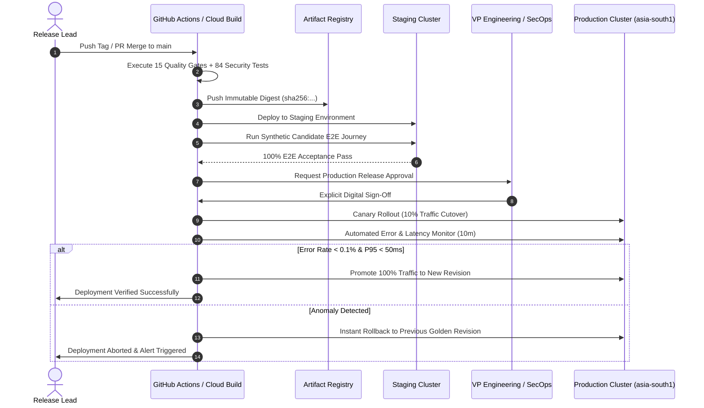

# PRAXIS InterviewOS — Production Deployment Guide

**Document ID**: PROD-DEPLOY-001  
**Milestone**: Phase 5 — Production Engineering & Deployment  
**Date**: 2026-11-01  
**Target Golden Branch**: `main`  
**Classification**: Operational Deployment Standard & Runbook  

---

## 1. Containerization & Reproducible Builds

PRAXIS provides production-hardened Dockerfiles in `docker/`:
1. **`docker/Dockerfile.api`**: Multi-stage build for FastAPI Core REST backend.
2. **`docker/Dockerfile.realtime`**: Speech-optimized container baking offline faster-whisper and Silero VAD.
3. **`docker/Dockerfile.worker`**: Background worker container packaging ARQ queue tasks and an HTTP health listener on port 8080.

### Container Security Invariants
- **Non-Root Execution**: Containers run under dedicated unprivileged user `praxis` (UID `10001`, GID `10001`).
- **Base Images**: Pinned to official, minimal Debian Bookworm slim images: `python:3.11-slim-bookworm` and `node:20-slim`.
- **Offline Model Baking**: The faster-whisper small model is pre-downloaded during Docker build into `/app/models/` with `HF_HUB_OFFLINE = 1`. No runtime downloads from HuggingFace occur.
- **Zero Embedded Credentials**: Build arguments and Dockerfile layers contain zero secrets, tokens, or environment passwords.

---

## 2. Local Container Build & Verification

```bash
# 1. Build Core REST API Image
docker build -t asia-south1-docker.pkg.dev/praxis-interviewos/praxis-containers/praxis-api:latest \
  -f docker/Dockerfile.api .

# 2. Build Realtime Speech Gateway Image
docker build -t asia-south1-docker.pkg.dev/praxis-interviewos/praxis-containers/praxis-realtime:latest \
  -f docker/Dockerfile.realtime .

# 3. Build Background Task Worker Image
docker build -t asia-south1-docker.pkg.dev/praxis-interviewos/praxis-containers/praxis-worker:latest \
  -f docker/Dockerfile.worker .
```

---

## 3. Step-by-Step Staging Deployment

### Step 1: Pre-Deployment Gate
Execute the local regression and quality gates:
```bash
uv run python scripts/final_quality_gate.py
uv run python scripts/check_backend_completeness.py
uv run python scripts/security/security_baseline.py
pnpm --filter @praxis/ui test
pnpm --filter desktop test
```

### Step 2: Push Container Images to Artifact Registry
```bash
# Tag with immutable commit SHA
export COMMIT_SHA=$(git rev-parse --short HEAD)
docker tag praxis-api:latest asia-south1-docker.pkg.dev/praxis-staging/praxis-containers/praxis-api:${COMMIT_SHA}
docker push asia-south1-docker.pkg.dev/praxis-staging/praxis-containers/praxis-api:${COMMIT_SHA}

docker tag praxis-realtime:latest asia-south1-docker.pkg.dev/praxis-staging/praxis-containers/praxis-realtime:${COMMIT_SHA}
docker push asia-south1-docker.pkg.dev/praxis-staging/praxis-containers/praxis-realtime:${COMMIT_SHA}

docker tag praxis-worker:latest asia-south1-docker.pkg.dev/praxis-staging/praxis-containers/praxis-worker:${COMMIT_SHA}
docker push asia-south1-docker.pkg.dev/praxis-staging/praxis-containers/praxis-worker:${COMMIT_SHA}
```

### Step 3: Apply Infrastructure Updates via Terraform
```bash
cd infra/terraform
terraform plan -var-file=environments/staging/terraform.tfvars -var="image_tag=${COMMIT_SHA}" -out=staging.tfplan
terraform apply staging.tfplan
```

### Step 4: Verify Deployment Health
```bash
# Liveness probe
curl -f https://staging-api.internal/health/liveness

# Readiness probe (verifies PostgreSQL and Redis ping)
curl -f https://staging-api.internal/health/readiness

# Realtime WebSocket probe
wscat -c wss://staging-realtime.internal/ws/interview/healthcheck
```

---

## 4. Production Deployment Workflow (Gated Release)



---

## 5. Graceful Shutdown & Lifecycle Management

- **SIGTERM Signal Handling**: Cloud Run provides 30 seconds before sending SIGKILL.
- **FastAPI / Uvicorn**: Stops accepting new connections, allows in-flight HTTP requests to complete, flushes OpenTelemetry trace buffers, and closes SQLAlchemy connection pools cleanly.
- **Realtime Gateway**: Sends WebSocket close frame (`code = 1001 Going Away`), saves partial transcript chunks to Redis, and closes active sessions.
- **ARQ Worker**: Completes currently active tasks within timeout budget, requeues unstarted jobs, and closes Redis connection.
