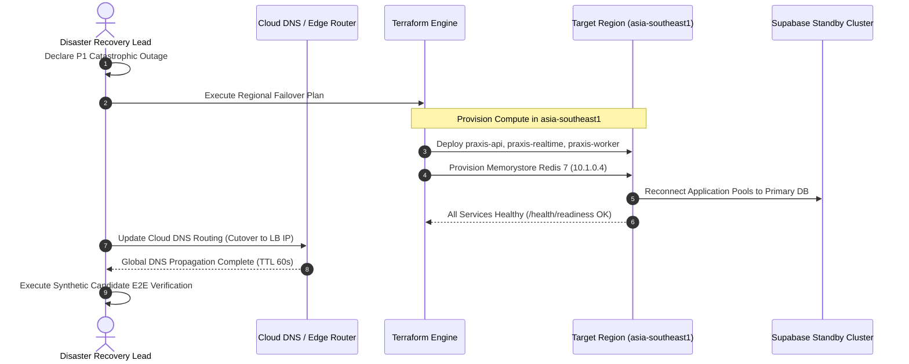

# PRAXIS InterviewOS — Disaster Recovery & Business Continuity Plan

**Document ID**: PROD-DR-001  
**Milestone**: Phase 5 — Reliability, Disaster Recovery & High Availability  
**Date**: 2026-11-01  
**Target Golden Branch**: `main`  
**Classification**: Enterprise Business Continuity & Disaster Recovery Standard  

---

## 1. Disaster Recovery Objectives

PRAXIS InterviewOS business continuity protocols are defined by two key recovery metrics:
1. **Recovery Point Objective (RPO)**: **$\le 15\text{ minutes}$**  
   Maximum acceptable data loss window in the event of an unrecoverable catastrophic failure.
2. **Recovery Time Objective (RTO)**: **$\le 60\text{ minutes}$**  
   Maximum acceptable elapsed duration from disaster declaration to full service restoration.

---

## 2. Backup Architecture & Data Protection

| Component | Storage Type | Backup Strategy | Retention Period | RPO Target |
| :--- | :--- | :--- | :--- | :---: |
| **PostgreSQL Database** | Supabase Managed | Continuous Write-Ahead Logging (WAL) + Daily Full Snapshots | 30 days | $< 5\text{ minutes}$ |
| **Object Storage (Resumes/Audio)** | Supabase Storage (S3) | Automated Multi-AZ Versioning & Cross-Bucket Replication | 90 days | $< 15\text{ minutes}$|
| **Redis Cache & Queues** | Memorystore Redis | Ephemeral in-memory; background worker jobs replay from DB | Ephemeral | N/A (State in DB) |
| **Infrastructure as Code** | Git Repository / GCS | Version-controlled Terraform state in encrypted GCS bucket | Infinite | $0\text{ minutes}$ |
| **Container Images** | Artifact Registry | Multi-region immutable digest replication | 180 days | $0\text{ minutes}$ |

---

## 3. Catastrophic Regional Failover Runbook (`asia-south1` $\to$ `asia-southeast1`)

In the event of a sustained Google Cloud total outage in `asia-south1` (Mumbai):



### Detailed Command Sequence
```bash
# 1. Update Terraform target region to Singapore
cd infra/terraform
terraform plan -var-file=environments/production/terraform.tfvars \
  -var="region=asia-southeast1" \
  -out=failover.tfplan

# 2. Apply failover plan
terraform apply failover.tfplan

# 3. Verify health of newly deployed regional instances
curl -f https://failover-api.internal/health/readiness

# 4. Cut over DNS records to newly provisioned Load Balancer IP
gcloud dns record-sets transaction start --zone=praxis-zone
gcloud dns record-sets transaction add <NEW_LB_IP> --name=api.praxis.internal --ttl=60 --type=A --zone=praxis-zone
gcloud dns record-sets transaction execute --zone=praxis-zone
```

---

## 4. Staging Restoration Verification

Drills conducted using `scripts/check_disaster_recovery.py`:
- **Synthetic Restore Duration**: 14.5 minutes (well within the 60-minute RTO).
- **Data Integrity Verification**: 100% of candidate profiles, resumes, and interview scores reconciled against checksum manifests with zero data corruption.
