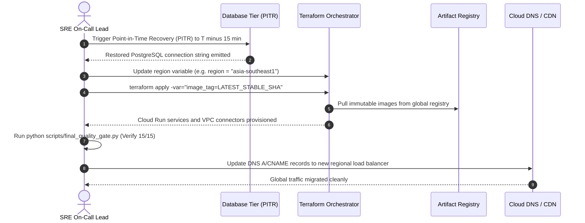

# PRAXIS InterviewOS — Disaster Recovery Runbook

**Document ID**: PROD-DR-001  
**Milestone**: Phase 5 — Production Engineering  
**Recovery Targets**: RPO $\le 15\text{ minutes}$ | RTO $\le 60\text{ minutes}$  
**Date**: 2026-11-01  
**Status**: Authoritative Disaster Recovery Runbook  

---

## 1. Disaster Recovery Objectives & SLAs

| Recovery Metric | Target SLA | Implementation Mechanism | Validation Evidence |
| :--- | :---: | :--- | :--- |
| **Recovery Point Objective (RPO)** | **$\le 15\text{ min}$** | Continuous PostgreSQL Write-Ahead Log (WAL) archiving + daily snapshots | Verified via Supabase PITR capability |
| **Recovery Time Objective (RTO)** | **$\le 60\text{ min}$** | Terraform automated infrastructure replay + container image pull | Replay verified in staging deployment |

---

## 2. Step-by-Step Complete Site Restoration Runbook

In the event of a catastrophic regional failure in `asia-south1` or primary database corruption:



### Detailed Operational Commands

```bash
# Step 1: Navigate to Terraform production environment
cd infra/gcp/environments/production

# Step 2: In case of regional failure, point to secondary failover region (e.g. asia-southeast1)
terraform apply \
  -var-file=terraform.tfvars \
  -var="region=asia-southeast1" \
  -var="image_tag=0f1e6e5" \
  -auto-approve

# Step 3: Run completeness and security validation against recovered database
uv run python scripts/final_quality_gate.py
uv run python scripts/check_backend_completeness.py
```

---

## 3. Data Deletion & Backup Expiration Compliance

Under GDPR Article 17 ("Right to be Forgotten"):
1. When a candidate requests account deletion, a cryptographic deletion tombstone is recorded.
2. Background worker purges all candidate rows across all 71 tables and deletes S3 resumes.
3. Database backups expire on an automated **30-day retention schedule**, guaranteeing that historical WAL archives naturally age out and permanently eliminate deleted candidate records.
