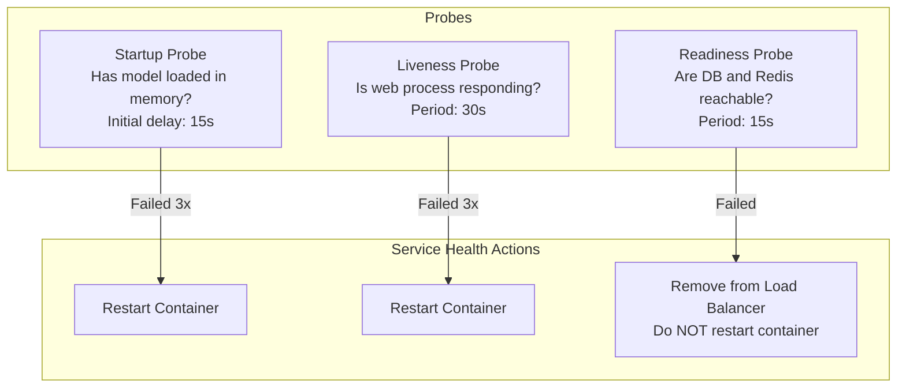
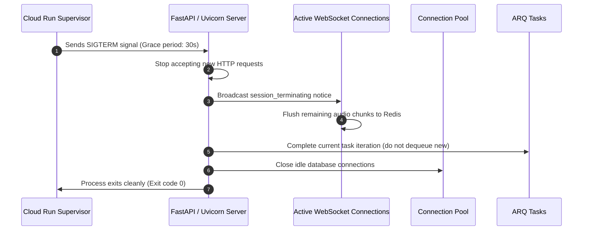

# PRAXIS InterviewOS — Health Checks & Service Lifecycle

**Document ID**: PROD-HEALTH-001  
**Milestone**: Phase 5 — Production Engineering  
**Endpoints**: `/health` (Liveness) & `/health/ready` (Readiness)  
**Date**: 2026-11-01  
**Status**: Authoritative Service Lifecycle Specification  

---

## 1. Healthcheck Architecture & Probing Strategy

To prevent cascading restarts caused by temporary third-party outages, PRAXIS decouples internal process liveness from external service readiness:

### 1.1 Endpoint Contracts
| Endpoint | Method | Checks Performed | Failure Action |
| :--- | :--- | :--- | :--- |
| **`/health` (Liveness)** | `GET` | Event loop responsiveness, memory ceiling | If 3 consecutive checks fail, Cloud Run restarts instance |
| **`/health/ready` (Readiness)** | `GET` | Database pool pre-ping, Redis `PING` | If check fails, instance is removed from traffic routing |

> [!NOTE]
> External LLM providers (e.g. OpenRouter, DeepSeek) are **never** queried in liveness probes. An external provider outage must never cause local API containers to crash or restart in a loop.

---

## 2. Container Lifecycle & Graceful Shutdown

When Google Cloud Run scales down or rolls out a new revision, it sends a `SIGTERM` signal to the container:

### 2.1 Graceful Shutdown Parameters
- **Uvicorn Grace Timeout**: `--timeout-graceful-shutdown 30` allows 30 seconds for pending HTTP requests and audio frames to drain before forced termination (`SIGKILL`).
- **ARQ Worker Draining**: The ARQ worker intercepts SIGTERM and completes its current in-flight task while refusing to pull new jobs from the queue.
- **WebSocket Closure Code**: Active interview sessions receive close code `1001` (Going Away), prompting the desktop client to attempt automatic reconnection to another active container instance.
