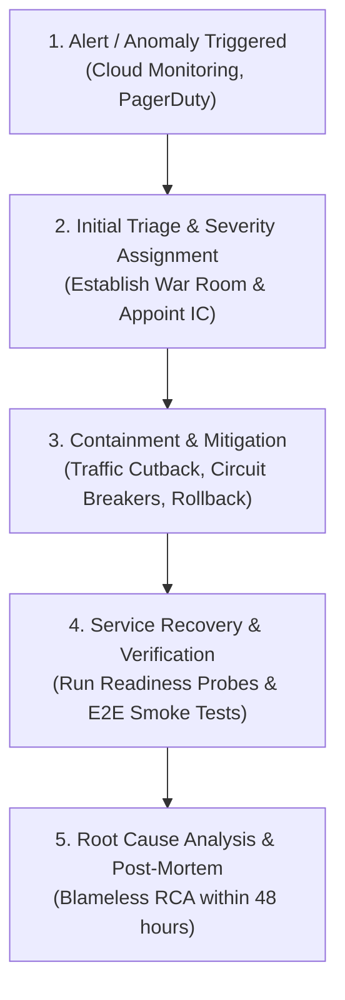

# PRAXIS InterviewOS — Incident Response & Triage Framework

**Document ID**: PROD-INC-001  
**Milestone**: Phase 5 — Production Reliability & SRE  
**Date**: 2026-11-01  
**Target Golden Branch**: `main`  
**Classification**: Enterprise SRE Protocol & Operational Incident Management  

---

## 1. Incident Severity Classification

| Severity Level | Definition | Impact Scope | Response SLA | Escalation Target |
| :--- | :--- | :--- | :---: | :--- |
| **P1 — Critical** | Total outage of Core API, Realtime Speech Gateway, or widespread data corruption. | $>25\%$ of active candidate sessions impacted; security breach. | $< 15\text{ minutes}$ | Engineering Lead, SecOps, VP Engineering |
| **P2 — Major** | Degraded functionality (e.g. STT fallback active, primary LLM unavailable, high latency). | Core features degraded but functional; fallback operational. | $< 30\text{ minutes}$ | Technical On-Call Engineer |
| **P3 — Minor** | Non-critical component degradation (e.g. background analytics delayed, study item sync lag). | Minor feature impact; core mock interview functional. | $< 4\text{ hours}$ | Module Owner / SRE Team |
| **P4 — Low** | Cosmetic issues, documentation defects, minor admin dashboard UI errors. | Minimal operational impact. | Next business day | Engineering Backlog |

---

## 2. Incident Response Lifecycle

---

## 3. Incident Command Structure

1. **Incident Commander (IC)**:
   - Owns the response process, sets meeting cadence, and assigns investigation streams.
   - Makes final decisions regarding service rollbacks or failover execution.
2. **Technical Lead (TL)**:
   - Diagnoses root cause, inspects distributed traces and logs, and formulates technical remediation.
3. **Communications Lead (CL)**:
   - Publishes status updates to external status page and enterprise stakeholders every 30 minutes during P1 incidents.

---

## 4. Emergency Escalation Channels

- **War Room Bridge**: Dedicated secure incident voice/video bridge.
- **Incident Channel**: `#incident-sev1-live` (Internal Slack/Teams).
- **Primary Pager Rotation**: Managed via Cloud Monitoring Alert Policies routed to on-call schedules.
- **Status Page**: `https://status.praxis.internal` (independent static hosting).

---

## 5. Post-Mortem Standards (Blameless RCA)

Every P1 and P2 incident mandates a post-mortem review within 48 hours:
1. **Executive Summary**: What happened, business impact, and resolution timeline.
2. **Incident Timeline**: Chronological log of events from initial failure to final recovery.
3. **Root Cause Analysis (5 Whys)**: Deep technical exploration of underlying architectural or process gaps.
4. **Action Items (Corrective & Preventive)**: Specific Jira issues assigned with owners and 14-day completion deadlines.
