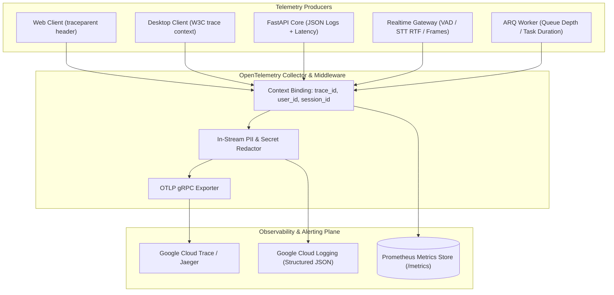

# PRAXIS InterviewOS — Observability & Telemetry Architecture

**Document ID**: PROD-OBS-001  
**Milestone**: Phase 5 — Production Observability, Tracing & Metrics  
**Date**: 2026-11-01  
**Target Golden Branch**: `main`  
**Classification**: Production Monitoring Specification & Telemetry Standard  

---

## 1. Unified Observability Architecture

PRAXIS InterviewOS implements a cohesive three-pillar observability framework consisting of OpenTelemetry distributed tracing, Prometheus real-time metrics, and structured JSON logs with in-stream PII redaction.



---

## 2. Distributed Tracing (W3C TraceContext)

- **Standard**: Follows W3C TraceContext specifications (`traceparent: 00-{trace_id}-{span_id}-{trace_flags}`).
- **Propagation Flow**:
  1. Client attaches `traceparent` to incoming REST requests or WebSocket query parameters.
  2. Middleware `backend/app/middleware.py` extracts the header, generates a correlation request ID if absent, and binds it to context via `backend/app/core/context.py`.
  3. When an ARQ background job is enqueued, the `trace_id` is serialized into the job payload and unpacked by the worker.
  4. Traces span API $\to$ Database $\to$ Redis Queue $\to$ Worker $\to$ AI Gateway $\to$ Realtime Audio Events.

---

## 3. Core Metrics Inventory

Exposed via `/metrics` endpoint using standard Prometheus format:

| Metric Name | Type | Description | Alert Threshold |
| :--- | :--- | :--- | :--- |
| **`praxis_http_requests_total`** | Counter | Total HTTP requests by path, method, status | Error rate $> 1.0\%$ over 5m |
| **`praxis_http_request_duration_seconds`** | Histogram | Request latency distribution | P95 latency $> 500\text{ ms}$ over 5m |
| **`praxis_db_pool_active_connections`** | Gauge | Active connections in SQLAlchemy pool | Active $> 4$ (of 5 max) per inst |
| **`praxis_db_pool_overflow_connections`**| Gauge | Overflow connections currently in use | Overflow $> 2$ for $> 3\text{ min}$ |
| **`praxis_redis_queue_depth`** | Gauge | Unprocessed jobs in ARQ queue | Queue depth $> 50$ jobs |
| **`praxis_worker_job_duration_seconds`** | Histogram | Execution time of background tasks | Duration $> 60\text{ s}$ |
| **`praxis_realtime_active_connections`** | Gauge | Concurrent active WebSocket audio streams | N/A (Capacity tracking) |
| **`praxis_realtime_dropped_frames_total`**| Counter | Audio frames dropped due to backpressure | Dropped frames $> 10/\text{min}$ |
| **`praxis_stt_rtf`** | Gauge | Real-Time Factor of speech recognition | RTF $> 0.50$ (Normal: $0.185$) |
| **`praxis_ai_provider_circuit_breaker`** | Gauge | Circuit breaker state (0=Closed, 1=Open) | Value $= 1$ (Open / Fallback active) |
| **`praxis_ai_tokens_consumed_total`** | Counter | Token usage aggregated by model/provider | Org cap approaching $\$50/\text{day}$ |

---

## 4. Structured Logging Schema & PII Masking

Logs are emitted to `stdout` in single-line structured JSON:
```json
{
  "timestamp": "2026-11-01T12:00:00.123Z",
  "severity": "INFO",
  "service": "praxis-api",
  "trace_id": "4bf92f3577b34da6a3ce929d0e0e4736",
  "span_id": "00f067aa0ba902b7",
  "user_id": "usr-9a8b7c6d",
  "message": "Resume upload completed successfully",
  "http": {
    "method": "POST",
    "path": "/api/v1/resumes/upload",
    "status_code": 200,
    "latency_ms": 42.5
  }
}
```

### In-Stream PII Redactor
All log formatters filter output through automated regex masks:
- **Bearer Tokens / JWTs**: `eyJ[A-Za-z0-9-_]+\.[A-Za-z0-9-_]+\.[A-Za-z0-9-_]+` $\to$ `[REDACTED_JWT]`
- **Passwords**: `("password"|"secret")\s*:\s*"[^"]+"` $\to$ `"password": "[REDACTED]"`
- **Email Addresses**: `[a-zA-Z0-9_.+-]+@[a-zA-Z0-9-]+\.[a-zA-Z0-9-.]+` $\to$ `[REDACTED_EMAIL]`

---

## 5. Health & Lifecycle Probes

1. **Liveness Probe (`GET /health/liveness`)**:
   - Validates that the Python event loop and HTTP server are responsive.
   - Returns `{"status": "ok"}` with HTTP 200 within 5ms.
2. **Readiness Probe (`GET /health/readiness`)**:
   - Executes an active `SELECT 1` on PostgreSQL and a `PING` on Redis.
   - If either dependency fails, returns HTTP 503 Service Unavailable, prompting Cloud Run to route traffic away from the unready instance.
