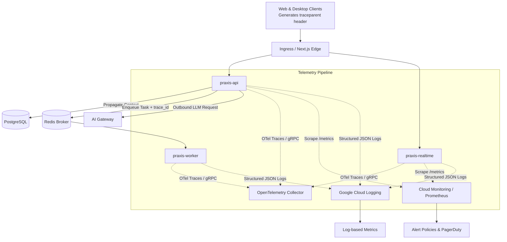

# PRAXIS InterviewOS — Observability & Telemetry Architecture

**Document ID**: PROD-OBS-001  
**Milestone**: Phase 5 — Production Engineering  
**Standards**: OpenTelemetry (W3C TraceContext), Prometheus Metrics, Structured JSON Logging  
**Date**: 2026-11-01  
**Status**: Authoritative Observability Specification  

---

## 1. Unified Telemetry Architecture

PRAXIS provides end-to-end visibility across its multi-service distributed architecture by correlating traces, metrics, and structured logs through OpenTelemetry:

---

## 2. Distributed Tracing & Context Propagation

1. **W3C Standard Compliance**: Requests propagate `traceparent: 00-4bf92f3577b34da6a3ce929d0e0e4736-00f067aa0ba902b7-01` across HTTP headers, WebSocket metadata, and ARQ queue payloads.
2. **Span Hierarchy**:
   - `http.request`: Root span initiated at FastAPI middleware.
   - `db.query`: Child span measuring PostgreSQL query execution.
   - `ai.inference`: Child span measuring LLM routing, token generation, and latency.
   - `worker.task`: Span initialized upon task dequeue, carrying root trace ID from HTTP request.
3. **Correlation in Logs**: Every log entry automatically embeds `trace_id` and `span_id`, allowing engineers to transition instantly from an alert spike to the exact request trace and correlated log output.

---

## 3. High-Value Observability Invariants

- **PII Scrubbing**: Logs and trace tags **never** contain candidate passwords, resume raw text, full audio buffers, or authorization bearer tokens.
- **Low-Cardinality Metrics**: Metric labels are strictly bounded to enums (e.g. `status_code="200"`, `provider="deepseek"`, `route="/sessions"`) to prevent metric cardinality explosion.
- **Low Overhead**: Telemetry instrumentation imposes $< 0.5\text{ ms}$ CPU overhead per request.
