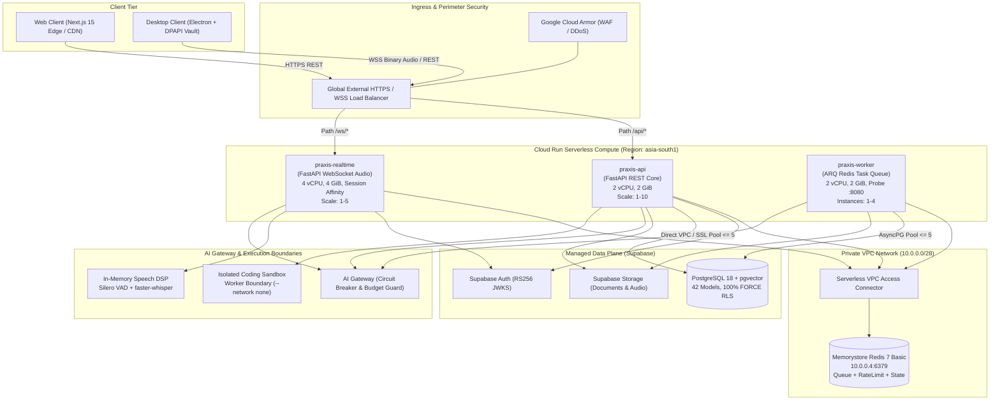

# PRAXIS InterviewOS — Production Architecture Specification

**Document ID**: PROD-ARCH-001  
**Milestone**: Phase 5 — Production Engineering & Operations  
**Date**: 2026-11-01  
**Target Golden Branch**: `main`  
**Classification**: Enterprise Production Architecture & Workload Boundary Matrix  

---

## 1. Executive Architecture Topology

PRAXIS InterviewOS operates as an integrated, multi-tier cloud platform designed for low-latency audio capture, streaming speech recognition, evidence-grounded AI evaluation, and resilient data persistence. The workload boundaries decouple user-facing HTTP request routing from stateful realtime WebSocket audio streams and heavy background worker tasks.

---

## 2. Complete Component Responsibility Matrix

| Component | Deployment Target | Runtime | Sizing (vCPU / RAM) | Scaling Behavior | Health Probes | Failure Domain & Recovery | Cost Driver |
| :--- | :--- | :--- | :---: | :--- | :--- | :--- | :--- |
| **Core API (`praxis-api`)** | Cloud Run (Gen 2) | Python 3.11 (Uvicorn) | 2 vCPU / 2 GiB | Autoscale: 1–10 instances (Concurrency: 80) | `/health/liveness` & `/health/readiness` | Stateless; instance crash triggers automated container restart within 3s. | CPU/RAM active runtime |
| **Realtime Gateway (`praxis-realtime`)** | Cloud Run (Gen 2) | Python 3.11 (FastAPI WSS) | 4 vCPU / 4 GiB | Autoscale: 1–5 instances (Concurrency: 20, Sticky WSS) | `/health/liveness` & WebSocket ping/pong (15s) | Client reconnects with session state retrieved from Redis; audio buffer reset. | vCPU & egress bandwidth |
| **Background Worker (`praxis-worker`)** | Cloud Run (Gen 2) | Python 3.11 (ARQ / asyncio) | 2 vCPU / 2 GiB | Fixed: 1–4 instances (Min: 1) | HTTP probe on port 8080 | Redis queue persists unacknowledged tasks; exponential retry with backoff. | Active instance CPU/RAM |
| **Session Cache & Queue** | Memorystore for Redis 7 | Redis 7.0 | 1 GiB – 2 GiB | Fixed instance tier | Native Redis `PING` / Cloud Monitoring | In-memory ephemeral; non-critical state evicted; DB is source of truth. | Fixed monthly tier |
| **Relational & Vector DB** | Supabase Managed Cloud | PostgreSQL 18 + pgvector | Dedicated Compute (2 vCPU) | Managed scaling; max 100 connections | Connection pre-ping & pg_isready | Multi-AZ automated failover; WAL replay; point-in-time recovery. | Database tier & storage |
| **Identity Provider** | Supabase Auth | Go / Auth Service | Managed SaaS | Elastic SaaS | Built-in HTTP health | Cached JWKS public keys allow offline local verification for 1 hour. | MAU tier |
| **Object Storage** | Supabase Storage (S3 API) | Cloud Storage | Elastic S3 API | Elastic auto-tier | S3 API availability check | Multi-regional replication; signed URL uploads with quarantine status. | GB stored & egress |
| **AI Gateway** | Shared Python Package | Python 3.11 (`packages/ai-gateway`) | In-process library | Scales with parent Cloud Run container | Provider health check & circuit breakers | Tripped circuit breaker routes traffic to fallback provider (OpenAI $\to$ Gemini $\to$ Flan-T5). | Token consumption |
| **Speech STT & VAD** | Embedded in `praxis-realtime` | CTranslate2 / PyTorch | Baked in container RAM | Scales with realtime container instances | In-memory inference self-test | Offline model baked in image (`HF_HUB_OFFLINE=1`); zero external latency. | Memory reservation |
| **Coding Sandbox** | Isolated Docker Worker | Python / gVisor / Linux | 1 vCPU / 256 MiB | Ephemeral per-execution | Process exit code & timeout probe | Hard kill on 5.0s timeout or 256 MiB OOM; `--network none` isolates host. | Container runtime seconds |
| **Web Client** | Next.js 15 App Router | Node.js 20 / Edge Runtime | Serverless Edge | Edge autoscaling | HTTP 200 on `/` route | Multi-region CDN caching; fallback UI error boundaries. | Edge function invocations |
| **Desktop Client** | Electron Windows 11 App | Chromium + Node.js 20 | Client Hardware | Local execution | Local diagnostic loopback probe | Local safeStorage encryption; graceful degradation to Web if desktop fails. | Zero cloud compute |

---

## 3. Workload Boundaries & Isolation Invariants

1. **Separation of Concerns**:
   - The Core API handles CRUD, candidate matching, and data persistence. It never handles raw WebSocket streaming.
   - The Realtime Gateway handles binary audio frames, VAD, and fast-path coaching. It delegates heavy AI reasoning and database writing to background workers or slow-path tasks.
   - The ARQ Worker handles document parsing, embedding generation, deep analytics, and GDPR deletion cascades.
2. **Network Isolation**:
   - Memorystore Redis is accessible only through the Serverless VPC Connector (`10.0.0.0/28`). Direct public access is disabled.
   - Supabase PostgreSQL communicates over TLS with enforced connection pooling limits (`DB_POOL_SIZE = 2, DB_MAX_OVERFLOW = 3`).
3. **Identity Boundary**:
   - All internal inter-service requests propagate candidate claims verified through RS256 JWKS tokens. Untrusted client tokens cannot override server-verified user boundaries.
