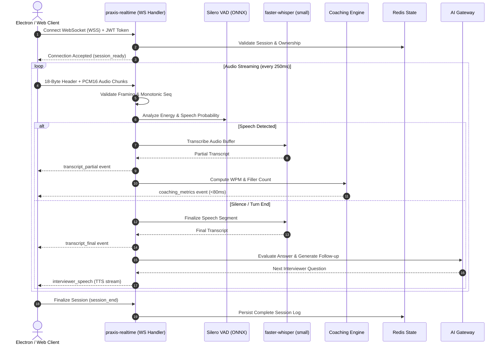

# PRAXIS InterviewOS — Realtime WebSocket & Audio Deployment

**Document ID**: PROD-RT-DEPLOY-001  
**Milestone**: Phase 5 — Production Engineering  
**Protocol Standard**: 18-Byte Monotonic Binary Framing (`>BBIdI`)  
**Audio Format**: Linear PCM16, Mono, 16,000 Hz (16 kHz)  
**Date**: 2026-11-01  
**Status**: Authoritative Realtime Deployment Specification  

---

## 1. Realtime Service Architecture

The PRAXIS Realtime Service (`realtime-agent`) operates as a stateful WebSocket engine deployed to Cloud Run Gen 2. It accepts streamed candidate audio frames, performs voice activity detection (VAD), runs local Speech-to-Text (STT), triggers fast coaching metrics, and synthesizes interviewer responses via Text-to-Speech (TTS).

---

## 2. Binary Wire Protocol Specifications

Binary audio payloads sent over WebSocket MUST adhere strictly to the 18-byte big-endian framing layout:

| Offset (Bytes) | Field Name | Type | Constraint | Description |
| :---: | :--- | :--- | :--- | :--- |
| `0` | `proto_ver` | `uint8` | `== 1` | Protocol version constant |
| `1` | `frame_type` | `uint8` | `== 1` | Frame type (1 = PCM16 audio) |
| `2..5` | `client_seq` | `uint32` (BE) | `seq > last_seq` | Monotonically increasing sequence number |
| `6..13` | `timestamp_ms`| `float64` (BE)| Monotonic | Client-side capture timestamp |
| `14..17` | `payload_len` | `uint32` (BE) | $\le 1,048,576$ & Even | Byte length of raw PCM16 audio payload |
| `18..N` | `audio_data` | `bytes` | `len == payload_len` | 16-bit signed PCM audio samples (16 kHz) |

### Validation & Defensive Rules
1. **Invalid Magic / Protocol Version**: Immediate disconnection with WebSocket close code `4400`.
2. **Non-Monotonic Sequence**: Rejects out-of-order or replayed frames with warning logged.
3. **Payload Ceiling**: Any frame claiming `payload_len > 1048576` (1 MB) is discarded immediately to prevent memory exhaustion attacks.
4. **Odd Byte Length**: Because 16-bit PCM samples require exactly 2 bytes per sample, any frame with `payload_len % 2 != 0` is rejected with `InvalidAudioFormat`.

---

## 3. Connection Reliability & Lifecycle Controls

- **Connection Heartbeats**: Ping/pong frames exchanged every 15 seconds. If no pong is received within 30 seconds, connection is terminated.
- **Idle Timeout**: Connections sending zero audio for 60 seconds are closed with code `4408` (Idle Timeout).
- **Session Timeout**: Maximum session duration capped at 3,600 seconds (1 hour).
- **Backpressure & Bounded Ring Buffers**: Client queues are constrained to 100 frames using a drop-oldest overflow strategy, ensuring memory remains bounded under high network jitter.
