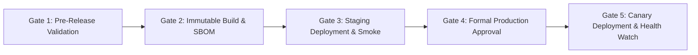

# PRAXIS InterviewOS — Production Release Process

**Document ID**: PROD-REL-PROC-001  
**Milestone**: Phase 5 — Production Engineering  
**Release Standard**: Immutable Digests, Staging Smoke Verification, Explicit Human Approval  
**Date**: 2026-11-01  
**Status**: Authoritative Release Process Specification  

---

## 1. End-to-End Release Lifecycle

The release lifecycle consists of 5 governed gates:

---

## 2. Gate-by-Gate Operational Checklist

### Gate 1: Pre-Release Quality & Security Validation
- [ ] Confirm git working tree is clean on `main`.
- [ ] Verify 15/15 checks pass: `uv run python scripts/final_quality_gate.py`.
- [ ] Verify 75/75 backend checks pass: `uv run python scripts/check_backend_completeness.py`.
- [ ] Verify 84 security controls pass: `uv run python scripts/security/security_baseline.py`.
- [ ] Verify web & desktop test suites pass: `pnpm --filter @praxis/ui test && pnpm --filter desktop test`.
- [ ] Verify production builds succeed: `pnpm build:web && pnpm build:desktop`.

### Gate 2: Immutable Artifact Build & Provenance
- [ ] BuildKit compiles containers tagging with `${SHORT_SHA}`.
- [ ] Capture image digests from Artifact Registry.
- [ ] Re-generate and verify SBOM: `uv run python scripts/security/generate_sbom.py`.
- [ ] Emit `release-manifest.json` recording Git SHA, image digests, and SBOM hash.

### Gate 3: Staging Deployment & Live Smoke Tests
- [ ] Deploy container digests to Cloud Run Staging (`project_id = "praxis-staging"`).
- [ ] Execute automated staging smoke tests:
  - `GET /health` returns HTTP 200 with database and Redis connectivity confirmed.
  - Candidate registration & JWT issuance verified.
  - Resume upload and background worker parsing verified.
  - WebSocket connection and 18-byte binary audio framing verified.
- [ ] Confirm zero 5xx errors in Cloud Logging during the staging evaluation window.

### Gate 4: Production Approval Protocol
- [ ] Release Engineering Lead reviews Staging Smoke Test results.
- [ ] Security Architect reviews `docs/security/PHASE4_RELEASE_READINESS.md`.
- [ ] Formal sign-off submitted in the GitHub Actions / Cloud Build release dashboard.

### Gate 5: Production Canary Deployment & Health Watch
- [ ] Deploy new revision to Cloud Run Production (`project_id = "praxis-production"`).
- [ ] Route 10% traffic to new revision for 10 minutes.
- [ ] If p95 latency $\le 3000\text{ms}$ and 5xx rate $\le 0.1\%$, migrate 100% of traffic.
- [ ] Maintain an active SRE 30-minute health watch post-deployment.
